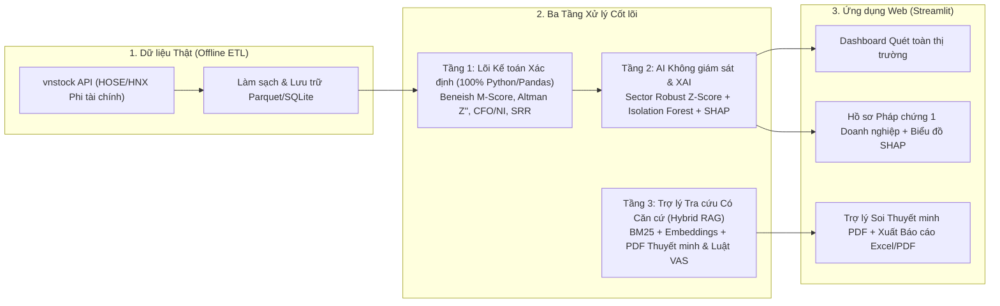

# BÁO CÁO TRI THỨC TOÀN DIỆN: TỪ CƠ BẢN ĐẾN NÂNG CAO
## DỰ ÁN `FinAudit AI — FinForensics`: Nền tảng AI Sàng lọc Rủi ro Chất lượng Lợi nhuận, Pháp chứng Báo cáo Tài chính & Minh bạch Quản trị (ESG-G)

> **Mục tiêu tài liệu:** Trang bị hệ thống kiến thức bài bản, dễ hiểu, có trích dẫn nguồn học thuật và kỹ thuật uy tín từ hai lĩnh vực **Kinh tế – Kế toán – Kiểm toán** và **Khoa học Dữ liệu – AI – Triển khai Web**, giúp người mới có thể nắm trọn bản chất nghiệp vụ, tự tay xây dựng mô hình, triển khai thành sản phẩm Web chạy thật và tự tin phản biện trước Ban Giám khảo cuộc thi **SE-Hackathon Challenge 2026 (Trường Kinh tế – Đại học Công nghiệp Hà Nội)**.

---

## MỤC LỤC NHANH

1. [CHƯƠNG 0: CHỐT PHƯƠNG ÁN TRIỂN KHAI TỐI ƯU THEO THỂ LỆ SE-HACKATHON 2026](#chương-0-chốt-phương-án-triển-khai-tối-ưu-theo-thể-lệ-se-hackathon-2026)
2. [PHẦN I: KIẾN THỨC KINH TẾ – KẾ TOÁN – KIỂM TOÁN & PHÁP CHỨNG TÀI CHÍNH](#phần-i-kiến-thức-kinh-tế--kế-toán--kiểm-toán--pháp-chứng-tài-chính)
   - [1.1. Mức Cơ bản: Đọc hiểu 3 Báo cáo Tài chính & Lý thuyết Kinh tế Nền tảng](#11-mức-cơ-bản-đọc-hiểu-3-báo-cáo-tài-chính--lý-thuyết-kinh-tế-nền-tảng)
   - [1.2. Mức Trung cấp: Chất lượng Lợi nhuận & Các Mô hình Pháp chứng Kinh điển](#12-mức-trung-cấp-chất-lượng-lợi-nhuận--các-mô-hình-pháp-chứng-kinh-điển)
   - [1.3. Mức Nâng cao: Chuẩn hóa theo Ngành, Quy định Việt Nam & Quản trị Rủi ro Pháp lý](#13-mức-nâng-cao-chuẩn-hóa-theo-ngành-quy-định-việt-nam--quản-trị-rủi-ro-pháp-lý)
3. [PHẦN II: KIẾN THỨC CÔNG NGHỆ THÔNG TIN, DỮ LIỆU, AI & TRIỂN KHAI WEB](#phần-ii-kiến-thức-công-nghệ-thông-tin-dữ-liệu-ai--triển-khai-web)
   - [2.1. Mức Cơ bản: Kiến trúc 3 Tầng, Hệ sinh thái Python & Dữ liệu BCTC Thật](#21-mức-cơ-bản-kiến-trúc-3-tầng-hệ-sinh-thái-python--dữ-liệu-bctc-thật)
   - [2.2. Mức Trung cấp: Học máy Không giám sát (Isolation Forest), Giải thích AI (SHAP) & Kiểm chứng](#22-mức-trung-cấp-học-máy-không-giám-sát-isolation-forest-giải-thích-ai-shap--kiểm-chứng)
   - [2.3. Mức Nâng cao: Hybrid RAG trên Thuyết minh PDF/Pháp lý & Triển khai Web Thực tế](#23-mức-nâng-cao-hybrid-rag-trên-thuyết-minh-pdfpháp-lý--triển-khai-web-thực-tế)
4. [PHẦN III: CẦU NỐI KHỞI NGHIỆP, TỪ ĐIỂN THUẬT NGỮ & TÀI LIỆU THAM KHẢO](#phần-iii-cầu-nối-khởi-nghiệp-từ-điển-thuật-ngữ--tài-liệu-tham-khảo)

---

## CHƯƠNG 0: CHỐT PHƯƠNG ÁN TRIỂN KHAI TỐI ƯU THEO THỂ LỆ SE-HACKATHON 2026

### 0.1. Phân tích Thể lệ Cuộc thi (Trường Kinh tế – ĐH Công nghiệp Hà Nội)
Theo *Thể lệ Cuộc thi “Sáng tạo – Khởi nghiệp vì tương lai bền vững – SE-Hackathon Challenge 2026”* (Kèm Kế hoạch số 640/KH-ĐHCN ngày 29/10/2026):
- **Hạn nộp bài Vòng Sơ loại:** Đến hết **25/11/2026** (gửi bản thuyết minh 12–15 trang, khổ A4, Times New Roman cỡ 14, kèm video tối đa 3 phút hoặc PowerPoint tối đa 10 trang).
- **Lộ trình tiếp theo:** Vòng Đào tạo (30/11–10/12), Vòng Bán kết (11/12–15/12), Vòng Chung kết trưng bày gian hàng (25/12/2026).
- **Trọng số chấm điểm Vòng Sơ khảo (100 điểm):**
  1. Sự cần thiết, tính mới, sáng tạo, giá trị khác biệt (**30 điểm**).
  2. Tính khả thi, tiềm năng và tính cạnh tranh (**20 điểm**).
  3. Thị trường mục tiêu, khách hàng, kế hoạch mở rộng thị trường (**20 điểm**).
  4. Nguồn lực thực hiện (**10 điểm**).
  5. Hiệu quả kinh tế – xã hội, ứng dụng thực tế và **tính bền vững** (**20 điểm**).

### 0.2. Quyết định Phương án Khả thi Nhất: `Phương án A — FinAudit AI (Lõi FinForensics)`
Với điều kiện thực tế của bạn (**máy tính RAM 32GB, chưa có sẵn file dữ liệu nội bộ nào, cần hoàn thiện MVP + Báo cáo dự thi trong 3 ngày trước hạn 25/11/2026**), phương án có xác suất thành công cao nhất (~90%) và phù hợp nhất với Ban Giám khảo Trường Kinh tế là:

- **Sản phẩm MVP (Giai đoạn 1 — Hoàn thiện trong 3 ngày):** **`FinAudit AI — FinForensics`**, nền tảng AI sàng lọc rủi ro chất lượng lợi nhuận, phát hiện dấu hiệu bất thường BCTC và đối chiếu Thuyết minh/Chuẩn mực kế toán cho doanh nghiệp Việt Nam.
- **Lý do chọn làm phương án tối ưu:**
  1. **100% Dữ liệu Thật, Minh bạch, Lấy ngay trong Ngày 1:** Không cần xin dữ liệu nhạy cảm của shop TMĐT hay tạo số giả. Toàn bộ BCTC 4–5 năm gần nhất của các doanh nghiệp **phi tài chính** niêm yết trên HOSE/HNX được thu thập trực tiếp từ nguồn dữ liệu tài chính công khai Việt Nam qua thư viện Python `vnstock`.
  2. **Khớp tuyệt đối chủ đề "Phát triển bền vững (ESG)":** Trong bộ khung **ESG** (*Environmental – Social – Governance*), minh bạch thông tin tài chính và phòng ngừa gian lận BCTC là lõi của **Trụ cột G (Governance – Quản trị doanh nghiệp bền vững)**. Hệ thống giúp bảo vệ nhà đầu tư nhỏ lẻ, giảm nợ xấu cho hệ thống ngân hàng và thúc đẩy thị trường vốn lành mạnh.
  3. **Sắc nét về Mô hình Kinh doanh:** Không bị loãng giữa hai tệp khách hàng rời rạc. Tập trung phục vụ hệ sinh thái thẩm định BCTC: **Ngân hàng thương mại (Tín dụng doanh nghiệp) – Công ty Kiểm toán – Nhà đầu tư & Sinh viên/Giảng viên Kinh tế**.
  4. **Tầm nhìn Mở rộng (Phase 2 — Khi vào Vòng Chung kết / Thương mại hóa):** Tích hợp mở rộng phân hệ `OmniReconcile` (đối soát giao dịch TMĐT, hóa đơn XML TT78 và thuế khấu trừ thay theo NĐ 117/2025 & NĐ 252/2026 cho SME/hộ kinh doanh) để hoàn chỉnh hệ sinh thái từ cấp giao dịch lên cấp báo cáo tài chính.

---

## PHẦN I: KIẾN THỨC KINH TẾ – KẾ TOÁN – KIỂM TOÁN & PHÁP CHỨNG TÀI CHÍNH

### 1.1. Mức Cơ bản: Đọc hiểu 3 Báo cáo Tài chính & Lý thuyết Kinh tế Nền tảng

#### A. Ba mảnh ghép của Báo cáo Tài chính (Theo Thông tư 99/2025/TT-BTC thay thế Thông tư 200/2014/TT-BTC — Chuẩn VAS)
> **Cập nhật Pháp lý Mới nhất (Hiệu lực từ 01/01/2026):** Ngày 27/10/2025, Bộ Tài chính đã ban hành **Thông tư số 99/2025/TT-BTC** hướng dẫn Chế độ kế toán doanh nghiệp, chính thức **thay thế Thông tư số 200/2014/TT-BTC** kể từ năm tài chính bắt đầu từ hoặc sau ngày **01/01/2026**. Điểm thay đổi quan trọng bậc nhất về hệ thống biểu mẫu (Phụ lục IV) là chính thức đổi tên *"Bảng cân đối kế toán"* thành **"Báo cáo tình hình tài chính"** (Mẫu số `B01-DN`) nhằm tiệm cận chuẩn mực quốc tế IFRS, đồng thời giữ nguyên nguyên tắc **không thay đổi "Mã số" cố định của các chỉ tiêu** — giúp hệ thống AI có thể liên thông liền mạch giữa dữ liệu BCTC lịch sử (2020–2025 lập theo TT 200/2014/TT-BTC) và BCTC từ năm 2026 trở đi (lập theo TT 99/2025/TT-BTC).

Một doanh nghiệp giống như một cơ thể sống. Báo cáo Tài chính (BCTC) là "hồ sơ khám sức khỏe" gồm **3 báo cáo định lượng cốt lõi** (đi kèm **Bản thuyết minh BCTC — Mẫu B09-DN**) liên kết chặt chẽ với nhau:

1. **Báo cáo Tình hình Tài chính (Statement of Financial Position — Mẫu B01-DN theo TT 99/2025/TT-BTC; trước năm 2026 gọi là *Bảng Cân đối Kế toán — BCĐKT*):** Là "bức ảnh chụp nhanh" tài sản và nguồn vốn tại một thời điểm (thường là ngày 31/12). Luôn tuân thủ phương trình bất biến:
   $$\text{Tổng Tài sản (Assets)} = \text{Nợ phải trả (Liabilities)} + \text{Vốn chủ sở hữu (Equity)}$$
   - *Tài sản ngắn hạn (TSNH):* Tiền và các khoản tương đương tiền (trong đó `TK 112` theo Phụ lục II TT 99/2025 được chuẩn hóa tên gọi là *Tiền gửi không kỳ hạn*), Phải thu ngắn hạn (tiền khách còn nợ), Hàng tồn kho... (chuyển thành tiền trong $\le 12$ tháng).
   - *Tài sản dài hạn (TSDH):* Tài sản cố định (nhà xưởng, máy móc), Tài sản sinh học, Chi phí xây dựng cơ bản dở dang, Đầu tư dài hạn...
   - *Nợ phải trả:* Nợ ngắn hạn (phải trả trong $\le 12$ tháng) và Nợ dài hạn.

2. **Báo cáo Kết quả Hoạt động Kinh doanh (Income Statement — Mẫu B02-DN — KQKD):** Là "đoạn phim" ghi lại doanh thu, chi phí và lợi nhuận trong cả một kỳ (1 quý hoặc 1 năm):
   - $\text{Doanh thu thuần} - \text{Giá vốn hàng bán (COGS)} = \text{Lợi nhuận gộp (Gross Profit)}$.
   - $\text{Lợi nhuận gộp} - \text{Chi phí bán hàng \& Quản lý DN (SG\&A)} \pm \text{Hoạt động tài chính} = \text{Lợi nhuận thuần từ HĐKD}$.
   - Sau khi trừ thuế TNDN ta có **Lợi nhuận sau thuế (Net Income — NI)**.
   - **Điểm cực kỳ quan trọng:** Báo cáo KQKD lập theo **nguyên tắc dồn tích (Accrual Basis)** — nghĩa là cứ xuất hóa đơn giao hàng là được ghi nhận Doanh thu và Lợi nhuận, **kể cả khi khách hàng chưa trả một đồng tiền mặt nào**.

3. **Báo cáo Lưu chuyển Tiền tệ (Cash Flow Statement — Mẫu B03-DN — LCTT):** Ghi nhận **tiền thật** chảy vào và chảy ra khỏi két/ngân hàng, chia làm 3 dòng:
   - **CFO (Cash Flow from Operating Activities):** Dòng tiền từ hoạt động kinh doanh cốt lõi. Đây là **dòng tiền quan trọng nhất** vì nó cho biết việc bán hàng có thực sự thu được tiền tươi hay không.
   - **CFI (Investing):** Tiền chi mua sắm máy móc/nhà xưởng hoặc thu từ bán tài sản/đầu tư.
   - **CFF (Financing):** Tiền đi vay ngân hàng, phát hành cổ phiếu, hoặc trả nợ gốc/cổ tức.

> **Ví dụ trực quan cho người mới:**  
> Công ty A bán lô hàng 100 tỷ đồng cho công ty sân sau với giá vốn 60 tỷ đồng, nhưng cho nợ 100% chưa thu tiền.  
> - Trên **KQKD (B02-DN):** Công ty báo lãi gộp **+40 tỷ đồng** (nhìn rất đẹp!).  
> - Trên **Báo cáo Tình hình Tài chính / BCĐKT (B01-DN):** Khoản mục *Phải thu ngắn hạn của khách hàng* phình to thêm **+100 tỷ đồng**.  
> - Trên **LCTT (B03-DN):** Dòng tiền kinh doanh `CFO` bị **âm -60 tỷ đồng** (vì đã bỏ tiền mua hàng nhưng chưa thu được đồng nào).  
> $\rightarrow$ **Bản chất của Pháp chứng Tài chính (Financial Forensics)** chính là **soi độ lệch giữa 3 báo cáo này** để phát hiện lợi nhuận "trên giấy" không đi kèm tiền thật.

#### B. Các Lý thuyết Kinh tế Giải thích Vì sao Gian lận & Thao túng BCTC Xảy ra
1. **Bất cân xứng Thông tin (Information Asymmetry — Akerlof, 1970):** Ban Giám đốc (người trong cuộc) nắm rõ tình hình thực tế của doanh nghiệp, trong khi ngân hàng, nhà đầu tư và cổ đông thiểu số (người bên ngoài) chỉ nhìn thấy BCTC đã qua xử lý. Sự chênh lệch này tạo ra rủi ro lựa chọn đối nghịch (*Adverse Selection* — ngân hàng cấp vốn nhầm cho doanh nghiệp yếu kém).
2. **Lý thuyết Đại diện (Agency Theory — Jensen & Meckling, 1976):** Mục tiêu của nhà quản lý (muốn đạt KPI thưởng, giữ giá cổ phiếu cao, đáp ứng điều kiện vay vốn ngân hàng) có thể xung đột với lợi ích dài hạn của cổ đông và chủ nợ, dẫn tới hành vi làm đẹp số liệu (*Earnings Management*).
3. **Tam giác Gian lận (Fraud Triangle — Cressey, 1953):** Gian lận tài chính thường phát sinh khi hội tụ đủ 3 yếu tố: **Áp lực** (sắp lỗ, sắp đến hạn trả nợ trái phiếu/ngân hàng), **Cơ hội** (kiểm soát nội bộ yếu, hội đồng quản trị thiếu độc lập), và **Biện minh** ("chỉ mượn số liệu năm nay, năm sau làm ăn tốt sẽ bù lại").
4. **Quy mô thiệt hại thực tế (ACFE, 2024):** Theo báo cáo *Occupational Fraud 2024: A Report to the Nations* của Hiệp hội Điều tra viên Gian lận Hoa Kỳ (ACFE) phân tích 1.921 vụ gian lận tại 138 quốc gia, **gian lận Báo cáo Tài chính** tuy chỉ chiếm **5%** số vụ nhưng lại gây **tổn thất trung vị (median loss) cao nhất trong mọi loại gian lận: 766.000 USD/vụ**.
5. **Kết nối với ESG (Trụ cột G — Governance):** Minh bạch thông tin kế toán, tính trung thực của BCTC và bảo vệ cổ đông thiểu số là thước đo cốt lõi của chữ **G** trong phát triển bền vững (ESG). Một nền kinh tế chỉ có thể phân bổ vốn hiệu quả và phát triển bền vững khi dòng vốn chảy vào doanh nghiệp làm ăn thật thay vì doanh nghiệp thổi phồng số liệu.

---

### 1.2. Mức Trung cấp: Chất lượng Lợi nhuận & Các Mô hình Pháp chứng Kinh điển

#### A. Chất lượng Lợi nhuận & Hiện tượng Dồn tích (Sloan, 1996; Dechow, Ge & Schrand, 2010)
Trong công trình kinh điển đăng trên tạp chí *The Accounting Review*, **Sloan (1996)** phân tách lợi nhuận thành 2 thành phần:

$$\text{Lợi nhuận (Earnings)} = \text{Dòng tiền HĐKD (CFO)} + \text{Khoản dồn tích (Accruals)}$$

- **Phát hiện cốt lõi:** Thành phần lợi nhuận đến từ **tiền mặt (`CFO`)** có tính bền vững cao hơn nhiều so với thành phần đến từ **dồn tích (`Accruals`)**. Tuy nhiên, nhà đầu tư thường "mắc bẫy" chỉ nhìn vào con số lợi nhuận ròng (*Earnings Fixation*).
- **Tổng quan của Dechow, Ge & Schrand (2010)** (*Journal of Accounting and Economics*): Nhấn mạnh không tồn tại một thước đo đơn lẻ hoàn hảo cho chất lượng lợi nhuận; cần kết hợp đa chỉ báo và tách biệt giữa *hiệu quả kinh doanh nền tảng* với *sự bóp méo do lựa chọn kế toán*.

Hai chỉ số cốt lõi hệ thống `FinAudit AI` sử dụng từ lý thuyết này:
1. **Tỷ số Chất lượng Dòng tiền (Cash Flow to Net Income Ratio):**
   $$\text{CFO/NI} = \frac{\text{Lưu chuyển tiền thuần từ HĐKD (CFO)}}{\text{Lợi nhuận sau thuế (NI)}}$$
   - *Diễn giải:* Doanh nghiệp khỏe mạnh thường có $\text{CFO/NI} \ge 1.0$. Nếu doanh nghiệp báo lãi dương nhưng $\text{CFO/NI} < 0.5$ hoặc âm liên tiếp 2–3 năm $\rightarrow$ **Cảnh báo chất lượng lợi nhuận thấp**.
2. **Tỷ số Dồn tích (Balance-Sheet / Cash-Flow Accrual Ratio):**
   $$\text{Accrual Ratio} = \frac{\text{Lợi nhuận sau thuế (NI)} - \text{CFO}}{\text{Tổng tài sản bình quân}}$$
   - *Diễn giải:* Chỉ số càng dương lớn (VD: $> +0.10$) nghĩa là lợi nhuận chủ yếu nằm trên sổ sách chứ không biến thành tiền mặt.

#### B. Mô hình Beneish M-Score (Beneish, 1999 — *Financial Analysts Journal*)
Giáo sư Messod D. Beneish (Đại học Indiana) xây dựng mô hình gồm **8 biến số tài chính** để phát hiện xác suất doanh nghiệp thao túng lợi nhuận (mô hình nổi tiếng vì đã từng phát hiện dấu hiệu bất thường của Enron từ trước khi sụp đổ).

**Công thức chuẩn:**
$$M = -4.84 + 0.920\cdot\text{DSRI} + 0.528\cdot\text{GMI} + 0.404\cdot\text{AQI} + 0.892\cdot\text{SGI} + 0.115\cdot\text{DEPI} - 0.172\cdot\text{SGAI} + 4.679\cdot\text{TATA} - 0.327\cdot\text{LVGI}$$

**Bảng giải nghĩa chi tiết 8 biến và ánh xạ sang BCTC Việt Nam (Thông tư 99/2025/TT-BTC & Thông tư 200/2014/TT-BTC):**

| Biến | Tên đầy đủ | Công thức toán học | Khoản mục BCTC Việt Nam tương ứng (Mã số B01-DN / B02-DN / B03-DN theo TT 99/2025 & TT 200/2014) | Ý nghĩa phát hiện rủi ro |
| :--- | :--- | :--- | :--- | :--- |
| **DSRI** | Days' Sales in Receivables Index | $\dfrac{\text{Phải thu}_t / \text{DT}_t}{\text{Phải thu}_{t-1} / \text{DT}_{t-1}}$ | Phải thu ngắn hạn KH (`131`) / Doanh thu thuần (`10`) | `DSRI > 1`: Phải thu tăng nhanh hơn doanh thu $\rightarrow$ nghi vấn bán chịu ồ ạt hoặc ghi nhận doanh thu ảo cuối kỳ. |
| **GMI** | Gross Margin Index | $\dfrac{\text{Biên LNG}_{t-1}}{\text{Biên LNG}_t}$ | Biên LNG = Lợi nhuận gộp (`20`) / Doanh thu thuần (`10`) | `GMI > 1`: Biên lãi gộp năm nay **giảm** so với năm trước $\rightarrow$ doanh nghiệp chịu áp lực kinh doanh suy giảm, tăng động cơ làm đẹp sổ. |
| **AQI** | Asset Quality Index | $\dfrac{1 - (\text{TSNH}_t + \text{TSCĐ}_t + \text{ĐT dài hạn}_t)/\text{TTS}_t}{1 - (\text{TSNH}_{t-1} + \text{TSCĐ}_{t-1} + \text{ĐT dài hạn}_{t-1})/\text{TTS}_{t-1}}$ | TSNH (`100`), TSCĐ (`220`), Tổng TS (`270`) | `AQI > 1`: Tỷ trọng tài sản dài hạn "mờ ám" (chi phí XDCB dở dang, tài sản dài hạn khác...) tăng lên $\rightarrow$ nghi vấn vốn hóa chi phí sai quy định. |
| **SGI** | Sales Growth Index | $\dfrac{\text{DT}_t}{\text{DT}_{t-1}}$ | Doanh thu thuần (`10`) kỳ $t$ / kỳ $t-1$ | Tăng trưởng doanh thu quá nóng tạo áp lực phải duy trì kỳ vọng và nhu cầu vốn lớn, dễ phát sinh sai lệch kế toán. |
| **DEPI** | Depreciation Index | $\dfrac{\text{KH}_{t-1}/(\text{TSCĐ}_{t-1}+\text{KH}_{t-1})}{\text{KH}_t/(\text{TSCĐ}_t+\text{KH}_t)}$ | **Quan trọng:** Lấy Khấu hao TSCĐ từ **LCTT gián tiếp** (`02`), TSCĐ hữu hình (`221`) | `DEPI > 1`: Tỷ lệ khấu hao giảm xuống $\rightarrow$ nghi vấn kéo dài thời gian sử dụng tài sản để giảm chi phí khấu hao, nâng lãi ảo. |
| **SGAI** | SG&A Expenses Index | $\dfrac{(\text{CPBH}_t + \text{CPQL}_t)/\text{DT}_t}{(\text{CPBH}_{t-1} + \text{CPQL}_{t-1})/\text{DT}_{t-1}}$ | Chi phí bán hàng (`25`) + Chi phí QLDN (`26`) | Phản ánh hiệu suất quản trị chi phí bán hàng & quản lý so với doanh thu. |
| **TATA** | Total Accruals to Total Assets | $\dfrac{\text{LN từ HĐKD}_t - \text{CFO}_t}{\text{Tổng tài sản}_t}$ | LN thuần HĐKD (`30`) hoặc LNST (`60`), CFO (`20` LCTT), Tổng TS (`270`) | **Biến có trọng số lớn nhất (`+4.679`):** Đo mức độ lợi nhuận kế toán không được bảo chứng bởi tiền mặt thực thu. |
| **LVGI** | Leverage Index | $\dfrac{\text{Tổng nợ phải trả}_t / \text{TTS}_t}{\text{Tổng nợ phải trả}_{t-1} / \text{TTS}_{t-1}}$ | Nợ phải trả (`300`) / Tổng tài sản (`270`) | `LVGI > 1`: Đòn bẩy nợ tăng mạnh $\rightarrow$ áp lực tuân thủ điều khoản vay vốn ngân hàng (debt covenants) tăng. |

- **Ngưỡng phân loại gốc của Beneish (1999):**
  - $M > -1.78$ (ví dụ: $-1.20$, $+0.50$): Có dấu hiệu rủi ro thao túng lợi nhuận cao (**Red Flag**).
  - $M \le -1.78$ (ví dụ: $-2.50$, $-3.10$): Ít có dấu hiệu thao túng theo mô hình Beneish.

#### C. Mô hình Altman $Z''$-Score cho Thị trường Mới nổi (Altman, 1995; Altman, 2005)
Nhiều người mới thường nhầm lẫn dùng công thức Altman Z-Score năm 1968 (vốn chỉ thiết kế cho công ty **sản xuất niêm yết tại Mỹ** và chứa tỷ số vòng quay tài sản vốn rất lệch giữa các ngành dịch vụ/thương mại). Với thị trường đang phát triển như **Việt Nam**, tài liệu tài chính chuẩn mực khuyến nghị sử dụng **Altman Emerging Market Score ($Z''$-Score)**:

$$Z'' = 3.25 + 6.56 X_1 + 3.26 X_2 + 6.72 X_3 + 1.05 X_4$$

Trong đó:
- $X_1 = \dfrac{\text{Vốn lưu động ròng (TSNH - Nợ ngắn hạn)}}{\text{Tổng tài sản}}$ *(Đo thanh khoản ngắn hạn)*
- $X_2 = \dfrac{\text{Lợi nhuận sau thuế chưa phân phối}}{\text{Tổng tài sản}}$ *(Đo sức tích lũy lợi nhuận qua nhiều năm)*
- $X_3 = \dfrac{\text{EBIT (Lợi nhuận trước lãi vay và thuế)}}{\text{Tổng tài sản}}$ *(Đo khả năng sinh lời thực chất từ tài sản, không phụ thuộc đòn bẩy)*
- $X_4 = \dfrac{\text{Giá trị sổ sách Vốn chủ sở hữu}}{\text{Tổng nợ phải trả}}$ *(Đo đệm an toàn vốn trước nợ vay — dùng giá trị sổ sách nên áp dụng được cho cả doanh nghiệp chưa niêm yết/SME!)*

**Ngưỡng phân loại rủi ro kiệt quệ tài chính (Theo chuẩn Altman Emerging Market Score 2005 đã cộng hằng số `+3.25` để ánh xạ sang thang xếp hạng trái phiếu):**
- **$Z'' > 5.85$** *(tương đương xếp hạng $\ge \text{BBB-}$)*: Vùng **An toàn (Safe Zone)** — Sức khỏe tài chính vững, xác suất kiệt quệ thấp.
- **$4.35 \le Z'' \le 5.85$** *(tương đương $\text{BB+}$ đến $\text{B-}$)*: Vùng **Xám / Cảnh báo (Grey Zone)** — Cần theo dõi chặt chẽ cấu trúc nợ và thanh khoản.
- **$Z'' < 4.35$** *(tương đương $\le \text{CCC+}$)*: Vùng **Nguy hiểm (Distress Zone)** — Rủi ro mất khả năng thanh toán / kiệt quệ tài chính cao.
*(Lưu ý học thuật: Bản phi sản xuất không cộng hằng số `+3.25` dùng ngưỡng `2.60 / 1.10`; khi cộng hằng số `+3.25` của bản Thị trường Mới nổi thì toàn bộ ngưỡng dịch chuyển tương ứng $+3.25$ lên **`5.85 / 4.35`**).*

> **Tại sao kết hợp cả Beneish M-Score và Altman $Z''$-Score lại cực mạnh?**  
> Một doanh nghiệp vừa rơi vào vùng nguy hiểm của **Altman $Z''$** (sức khỏe yếu, áp lực nợ lớn $\rightarrow$ có *động cơ* làm đẹp sổ sách), vừa vượt ngưỡng **Beneish M-Score** (có *dấu hiệu* dồn tích bất thường) chính là đối tượng có mức độ ưu tiên kiểm toán cao nhất!

---

### 1.3. Mức Nâng cao: Chuẩn hóa theo Ngành, Quy định Việt Nam & Quản trị Rủi ro Pháp lý

#### A. Bộ Chỉ số Pháp chứng Đặc thù cho Doanh nghiệp Việt Nam
Bên cạnh hai mô hình quốc tế, thực tiễn thị trường vốn Việt Nam có những "điểm nóng" kế toán rất đặc trưng mà hệ thống cần bổ sung:
1. **Tỷ trọng Khoản mục Nhạy cảm (`Sensitive Receivables Ratio`):**
   $$\text{SRR} = \frac{\text{Phải thu khác (ngắn \& dài hạn)} + \text{Trả trước cho người bán}}{\text{Tổng tài sản}}$$
   *Ý nghĩa:* Trong nhiều vụ việc bất thường trên thị trường Việt Nam, dòng tiền rút ra ngoài doanh nghiệp hoặc chuyển sang bên liên quan thường "ẩn náu" tại *Phải thu khác* (hợp tác kinh doanh, đặt cọc dự án) và *Trả trước cho người bán* thay vì *Phải thu khách hàng* thông thường.
2. **Tỷ lệ Nợ vay trên Vốn chủ sở hữu (`Debt-to-Equity`) & Tỷ trọng Hàng tồn kho bất thường (`Inventory / Total Assets`):** Hàng tồn kho tăng đột biến không đi kèm doanh thu có thể che giấu hàng lỗi thời chưa trích lập dự phòng giảm giá.

#### B. Căn cứ Pháp lý Kế toán – Kiểm toán Việt Nam (Phục vụ Trợ lý RAG & Phản biện)
1. **Chuẩn mực Kiểm toán Việt Nam số 240 (VSA 240 — Thông tư 214/2012/TT-BTC):** Quy định trách nhiệm của kiểm toán viên đối với gian lận trong quá trình kiểm toán BCTC. Hai nguyên tắc vàng bắt buộc trích dẫn:
   - Luôn duy trì *thái độ hoài nghi nghề nghiệp* (Professional Skepticism);
   - *Mặc định tồn tại rủi ro gian lận trong việc ghi nhận doanh thu* và rủi ro Ban Giám đốc vượt khống kiểm soát nội bộ.
2. **Quy định về Trích lập Dự phòng & Lập BCTC — Phân định rạch ròi giữa Chuẩn Kế toán (`Thông tư 200/2014/TT-BTC` $\rightarrow$ `Thông tư 99/2025/TT-BTC`) và Chuẩn Thuế (`Thông tư 48/2019/TT-BTC`):**
   - **Căn cứ lập và trình bày Báo cáo Tài chính (Mục đích Kế toán):** Theo ngay **Khoản 1 Điều 1 Thông tư 48/2019/TT-BTC**, Thông tư 48 chỉ hướng dẫn trích lập dự phòng làm cơ sở xác định *chi phí được trừ khi tính thuế TNDN*, còn **"việc trích lập các khoản dự phòng cho mục đích lập và trình bày Báo cáo tài chính của các tổ chức kinh tế thực hiện theo pháp luật về kế toán"**. Cụ thể:
     - Đối với dữ liệu BCTC lịch sử (các năm tài chính từ **2025 trở về trước**): Việc ghi nhận, trích lập dự phòng tổn thất tài sản và dự phòng phải thu khó đòi (`TK 229 / TK 2293`), nguyên tắc ghi nhận doanh thu (`TK 511`), phải thu khách hàng (`TK 131`), trả trước người bán (`TK 331`), phải thu khác (`TK 138`) trên BCTC tuân thủ theo **Thông tư 200/2014/TT-BTC** (Điều 45 về nguyên tắc ước tính kế toán mức tổn thất thực tế có bằng chứng đáng tin cậy).
     - Đối với năm tài chính bắt đầu **từ hoặc sau ngày 01/01/2026**: Chính thức áp dụng **Thông tư 99/2025/TT-BTC** (ban hành ngày 27/10/2025, thay thế Thông tư 200/2014/TT-BTC), bao gồm Hệ thống tài khoản kế toán tại **Phụ lục II** và Hệ thống Báo cáo tài chính tại **Phụ lục IV** (`B01-DN: Báo cáo tình hình tài chính`, `B02-DN: Báo cáo kết quả hoạt động kinh doanh`, `B03-DN: Báo cáo lưu chuyển tiền tệ`, `B09-DN: Bản thuyết minh BCTC`).
   - **Khung tham chiếu tuổi nợ & Chi phí thuế (Đối chiếu bổ trợ theo Thông tư 48/2019/TT-BTC & Thông tư 24/2022/TT-BTC):** Trong thực tiễn kế toán và kiểm toán tại Việt Nam, khi ước tính mức trích lập dự phòng phải thu khó đòi (`TK 2293`) và đối chiếu nghĩa vụ thuế TNDN, các doanh nghiệp và kiểm toán viên thường tham chiếu khung tỷ lệ theo tuổi nợ quá hạn (6 tháng đến < 1 năm: **30%**; 1 năm đến < 2 năm: **50%**; 2 năm đến < 3 năm: **70%**; từ 3 năm trở lên: **100%**). Nếu doanh nghiệp có các khoản phải thu khách hàng (`TK 131`) hoặc phải thu khác (`TK 138`) phình to, quá hạn kéo dài nhưng không trích lập hoặc trích lập thiếu dự phòng trên BCTC theo nguyên tắc thận trọng của **Thông tư 200/2014/TT-BTC (và nay là Thông tư 99/2025/TT-BTC)**, đó là dấu hiệu trọng yếu của việc **che giấu chi phí để làm đẹp lợi nhuận**.
3. **Chuẩn mực Kế toán Việt Nam số 26 (VAS 26 — Thông tin về các bên liên quan):** Bắt buộc doanh nghiệp phải thuyết minh chi tiết tính chất mối quan hệ, giá trị giao dịch và số dư công nợ (phải thu, trả trước, cho vay) với các bên liên quan trên Bản thuyết minh BCTC (`B09-DN`).

#### C. Nguyên tắc Lọc Ngành (ICB) & Chuẩn hóa theo Nhóm Ngành (*Peer-Group Robust Z-Score*)
- **Bắt buộc loại bỏ Định chế Tài chính (Ngân hàng, Chứng khoán, Bảo hiểm):** Các đơn vị này hoạt động theo mẫu BCTC riêng (TT 49/2014/TT-NHNN cho ngân hàng, TT 210/2014/TT-BTC cho công ty chứng khoán), không có khoản mục *Giá vốn hàng bán*, *Hàng tồn kho* hay *Tài sản ngắn hạn/dài hạn* như doanh nghiệp phi tài chính. Đưa nhóm này vào công thức Beneish/Altman là **sai về mặt học thuật**.
- **Tại sao phải so sánh với chính ngành của doanh nghiệp (Sector Benchmarking)?** Doanh nghiệp Bất động sản luôn có tỷ lệ Hàng tồn kho/Tổng tài sản cao (40–60%), trong khi doanh nghiệp Phần mềm/Công nghệ gần như bằng 0%. Thay vì áp một ngưỡng cứng cho mọi ngành, ta tính **Robust Z-Score theo từng ngành ICB**:
  $$z_{\text{robust}}(x) = \frac{x - \text{Median}_{\text{ngành}}}{1.4826 \times \text{MAD}_{\text{ngành}}}$$
  *(Trong đó $\text{MAD} = \text{Median}(|x - \text{Median}|)$ là độ lệch tuyệt đối trung vị; dùng Median & MAD giúp công thức không bị kéo lệch bởi vài công ty quá dị biệt trong ngành).*

#### D. Chuẩn mực Ngôn từ & Rủi ro Pháp lý (Cực quan trọng khi thuyết trình)
- **KHÔNG BAO GIỜ** kết luận một doanh nghiệp niêm yết công khai là *"Công ty gian lận"* chỉ từ mô hình định lượng. Việc kết luận gian lận thuộc thẩm quyền của Kiểm toán độc lập và Cơ quan quản lý nhà nước.
- **CÁCH DIỄN ĐẠT CHUẨN KIỂM TOÁN:** Sử dụng thang cảnh báo 3 cấp độ: **Thấp (Bình thường)** – **Trung bình (Cần theo dõi)** – **Cao (Có nhiều chỉ báo rủi ro / Red Flags cần kiểm tra sâu Thuyết minh & chứng từ gốc)**. Cách định vị này vừa đúng chuyên môn, vừa an toàn tuyệt đối về mặt pháp lý khi thương mại hóa.

#### E. Tầm nhìn Mở rộng Giai đoạn 2 (`OmniReconcile` — Định hướng Sau Cuộc thi)
Trong báo cáo dự thi, bạn trình bày `FinForensics` là **Lõi sản phẩm đã hoàn thiện MVP (Giai đoạn 1)** và giới thiệu **Giai đoạn 2 mở rộng sang SME & TMĐT (`OmniReconcile`)** bám sát xu thế pháp lý Việt Nam 2025–2026:
- **Nghị định 117/2025/NĐ-CP** (hiệu lực 01/07/2025) & **Nghị định 252/2026/NĐ-CP** (hiệu lực 01/07/2026): Sàn TMĐT có chức năng thanh toán khấu trừ, kê khai và nộp thay thuế GTGT, TNCN ngay trên từng giao dịch cho hộ/cá nhân kinh doanh.
- **Ngưỡng doanh thu chịu thuế 1 tỷ đồng/năm** áp dụng từ 01/01/2026 đối với hộ, cá nhân kinh doanh: Tạo ra nhu cầu lớn trong tương lai về phần mềm tự động đối soát doanh thu đa sàn, hóa đơn điện tử XML TT78 và hồ sơ hoàn/quyết toán thuế.

---

## PHẦN II: KIẾN THỨC CÔNG NGHỆ THÔNG TIN, DỮ LIỆU, AI & TRIỂN KHAI WEB

### 2.1. Mức Cơ bản: Kiến trúc 3 Tầng, Hệ sinh thái Python & Dữ liệu BCTC Thật

#### A. Tư duy Kiến trúc Đúng: "Tính toán Xác định + AI Giải thích + RAG Có Căn cứ"
Sai lầm phổ biến nhất của người mới làm AI tài chính là **đưa cả bảng số liệu vào ChatGPT/LLM rồi nhờ nó tự tính và chấm điểm**. Điều này cực kỳ nguy hiểm vì LLM bản chất là mô hình sinh ngôn ngữ xác suất, rất dễ cộng trừ sai hoặc bịa số liệu (*Hallucination*).

`FinAudit AI` áp dụng kiến trúc **3 Tầng tách bạch trách nhiệm**:

1. **Tầng 1 (Deterministic Core):** Python & Pandas tính toàn bộ công thức tài chính. Chính xác toán học 100%, không bao giờ sai số.
2. **Tầng 2 (Unsupervised ML + XAI):** Học máy phát hiện mẫu hình bất thường đa chiều so với chuẩn ngành và giải thích lý do bằng biểu đồ trực quan.
3. **Tầng 3 (Grounded RAG):** Tìm đúng đoạn văn bản trong Thuyết minh PDF (`B09-DN`) hoặc chuẩn mực kế toán – kiểm toán (`VAS`, `Thông tư 99/2025/TT-BTC`, `Thông tư 200/2014/TT-BTC`, `VSA 240`, `Thông tư 48/2019/TT-BTC`) để đối chiếu. **Cấm tuyệt đối AI tự bịa con số kế toán.**

#### B. Hệ sinh thái Công cụ Python Người mới Cần Nắm (Tối ưu cho RAM 32GB & 3 Ngày)

| Nhóm | Thư viện / Công cụ | Vai trò dễ hiểu | Tại sao chọn cho dự án này? |
| :--- | :--- | :--- | :--- |
| **Môi trường** | `Python 3.10+`, `venv`, `Jupyter Notebook` | Không gian thử nghiệm từng bước (`.ipynb`) và đóng gói chạy thật (`.py`) | Dễ kiểm tra từng bảng số liệu, lưu lại bằng chứng trực quan để đưa vào báo cáo. |
| **Thu thập dữ liệu** | `vnstock` | Lấy BCTC thật (CĐKT, KQKD, LCTT) và danh sách ngành ICB doanh nghiệp VN | Miễn phí, chuẩn hóa theo VAS, lấy được dữ liệu nhiều năm ngay lập tức. |
| **Xử lý dữ liệu** | `pandas`, `numpy`, `pyarrow` (Parquet) | Đọc, làm sạch, tính toán chỉ số tài chính và lưu file tốc độ siêu nhanh | File `.parquet` gọn hơn CSV 5–10 lần, giúp Web load toàn bộ thị trường trong < 1 giây. |
| **Học máy & XAI** | `scikit-learn` (`IsolationForest`), `shap` | Phát hiện bất thường đa biến và giải thích mức đóng góp của từng chỉ số | Chuẩn mực công nghiệp, nhẹ, chạy trong vài giây trên CPU của máy 32GB RAM. |
| **Đọc PDF & RAG** | `pymupdf` (`fitz`), `rank_bm25`, `sentence-transformers` (hoặc TF-IDF/API) | Đọc file PDF Thuyết minh BCTC và tìm đúng đoạn giải trình liên quan | `pymupdf` đọc PDF siêu nhanh; `BM25` bắt cực chuẩn từ khóa tài chính tiếng Việt. |
| **Biểu đồ & Web** | `plotly`, `streamlit` | Vẽ biểu đồ tương tác đẹp (Radar, Waterfall, Xu hướng) và dựng Web App | Viết 100% bằng Python, không cần học HTML/JS phức tạp, deploy miễn phí rất nhanh. |

#### C. Kỹ thuật Xử lý Dữ liệu Tài chính Đúng Chuẩn (Tránh 4 lỗi chết người của người mới)
1. **Lỗi chia cho 0 (`ZeroDivisionError` / `inf`):** Nhiều doanh nghiệp có `Lợi nhuận gộp = 0`, `Nợ phải trả = 0`, hoặc `Doanh thu năm trước = 0`. Luôn viết hàm chia an toàn `safe_div(a, b)` trả về `NaN` khi `b == 0` hoặc `|b| < 1e-6`.
2. **Lỗi điền bừa số `0` cho dữ liệu thiếu (`fillna(0)`):** Nếu thiếu dữ liệu năm $t-1$ mà điền `0`, tỷ số tăng trưởng sẽ thành vô cực hoặc `0`, làm sai lệch toàn bộ mô hình! **Quy tắc đúng:** Giữ `NaN` ở bước tính tỷ số, đánh dấu trạng thái `data_completeness`, và chỉ thay thế bằng **trung vị ngành (Sector Median)** ngay trước bước đưa vào `Isolation Forest` (đồng thời gắn cờ ghi chú minh bạch).
3. **Lỗi ngoại lai cực đoan (Extreme Outliers):** Ví dụ một doanh nghiệp năm trước doanh thu 1 tỷ, năm nay 500 tỷ $\rightarrow$ `SGI = 500`, khiến điểm Beneish vọt lên +450 và phá hỏng trục biểu đồ lẫn thuật toán ML. **Quy tắc đúng:** Áp dụng **Winsorization (Cắt ngưỡng phân vị 1% – 99%)** trước khi chuẩn hóa đưa vào mô hình học máy, nhưng vẫn **hiển thị giá trị gốc** khi người dùng xem chi tiết để đảm bảo trung thực kế toán.
4. **Lỗi Rò rỉ Dữ liệu Thời gian (Look-ahead Bias / Data Leakage):** Khi kiểm chứng cho năm 2023, mọi thông số chuẩn ngành (Median/MAD của ngành) và mô hình chỉ được tính trên dữ liệu tính đến năm 2023 (không dùng dữ liệu tương lai năm 2024–2025).

---

### 2.2. Mức Trung cấp: Học máy Không giám sát (`Isolation Forest`), Giải thích AI (`SHAP`) & Kiểm chứng

#### A. Thuật toán `Isolation Forest` (Liu, Ting & Zhou, 2008 — *IEEE ICDM*)
- **Vấn đề đặt ra:** Tại sao ta chọn *Học máy Không giám sát (Unsupervised Learning)* thay vì *Có giám sát (Supervised — như XGBoost)* trong 3 ngày?
  - Học máy có giám sát bắt buộc phải có hàng nghìn nhãn "Gian lận / Không gian lận" đã được kiểm chứng. Khi chưa có bộ nhãn thật chuẩn hóa, ép chạy XGBoost sẽ dẫn đến nhãn giả hoặc rò rỉ dữ liệu.
  - **Isolation Forest** không cần nhãn gian lận; nó tự học phân phối bình thường của hàng trăm doanh nghiệp trong cùng nhóm ngành và tự động phát hiện những doanh nghiệp có **tổ hợp nhiều chỉ số tài chính bất thường đồng thời**.
- **Nguyên lý hoạt động (giải thích trực quan):**
  - Hãy tưởng tượng mỗi doanh nghiệp là một chấm điểm trong không gian đa chiều (gồm 12 chỉ số: DSRI, GMI, AQI, TATA, CFO/NI, Altman $Z''$, Phải thu khác/Tổng TS...).
  - Thuật toán liên tục vẽ các đường cắt ngẫu nhiên để tách riêng từng điểm dữ liệu thành cây nhị phân (*Isolation Trees*).
  - **Điểm bình thường** nằm chen chúc ở vùng đông đúc nên cần **rất nhiều nhát cắt (đường đi dài)** mới tách riêng được nó.
  - **Điểm bất thường (Anomaly)** nằm lạc lõng xa đám đông nên chỉ cần **rất ít nhát cắt (đường đi ngắn)** là bị cô lập ngay!
- **Các tham số cốt lõi cần hiểu:**
  - `n_estimators = 200`: Số lượng cây cô lập (càng nhiều càng ổn định; 200–300 cây là lý tưởng cho dữ liệu bảng tài chính, chạy mất < 0,5 giây).
  - `contamination = 0.08` (hoặc `0.10`): Tỷ lệ ước lượng nhóm điểm bất thường cao nhất (VD: top 8%–10% doanh nghiệp cần ưu tiên rà soát kiểm toán).
  - `max_samples = 'auto'`: Kích thước mẫu con mỗi cây (mặc định tối đa 256, giúp chống hiệu ứng che lấp — *swamping/masking*).
  - `random_state = 42`: Cố định hạt giống ngẫu nhiên để **kết quả chạy lại bao nhiêu lần cũng ra đúng một con số (Reproducibility)**.
- **Chuẩn hóa điểm sang Thang Rủi ro Tổng hợp (`FinForensics Risk Score: 0 – 100`):**
  Để giám khảo kinh tế dễ đọc thay vì nhìn con số âm/dương khó hiểu của hàm `decision_function`, ta xây dựng thang điểm tổng hợp minh bạch, kết hợp trọng số rõ ràng từ 3 trụ cột:
  $$\text{Composite Risk Score} = 0.35 \times S_{\text{Beneish}} + 0.25 \times S_{\text{Altman}} + 0.15 \times S_{\text{CashQuality}} + 0.25 \times S_{\text{IsoForest}}$$
  *(Mỗi thành phần $S_i$ được quy đổi tuyến tính/phân vị về thang `0 – 100`, trong đó `0–39`: Rủi ro Thấp, `40–64`: Cần Theo dõi, `65–100`: Cảnh báo Cao — Cần kiểm toán sâu).*

#### B. AI Có Giải thích — `SHAP` (Lundberg & Lee, 2017 — *NeurIPS*)
- **Vấn đề "Hộp đen" (Black-box AI):** Nếu AI chỉ in ra *"Công ty X có điểm rủi ro 84/100"*, kiểm toán viên và ngân hàng sẽ **không dám tin và không biết kiểm tra từ đâu**.
- **SHAP (SHapley Additive exPlanations):** Dựa trên **Lý thuyết Trò chơi hợp tác** của Lloyd Shapley (Giải Nobel Kinh tế 2012!). Coi mỗi chỉ số tài chính là một "người chơi" cùng đóng góp vào điểm rủi ro cuối cùng; giá trị SHAP tính toán công bằng xem **chỉ số nào đẩy điểm rủi ro tăng lên (+)** và **chỉ số nào kéo điểm rủi ro giảm xuống (-)**.
- **Áp dụng trong dự án:**
  - Dùng `shap.TreeExplainer` trực tiếp trên mô hình cây `IsolationForest` (phiên bản `shap` hiện đại hỗ trợ trực tiếp `IsolationForest`!).
  - Kết quả vẽ thành **Biểu đồ Thác nước (Waterfall / Horizontal Bar Chart)** hiển thị **Top 5 yếu tố kéo điểm rủi ro lên cao nhất**, kèm phiên dịch sang tiếng Việt kinh tế (VD: *"`TATA = +0.24` (Dồn tích cao bất thường, làm tăng +18.5 điểm rủi ro): Lợi nhuận kế toán cao hơn rất nhiều so với dòng tiền thực thu CFO"*).

#### C. Quy trình Kiểm chứng Khoa học Không cần "Bịa Nhãn" (4 Lớp Đối chứng)
Để chứng minh mô hình thực sự đáng tin cậy trước hội đồng giám khảo mà không bịa đặt bất kỳ con số nào, dự án kiểm chứng qua **4 phương pháp khoa học minh bạch**:
1. **Kiểm chứng Toán học (Unit Testing):** Kiểm tra chéo 100% công thức Beneish, Altman $Z''$, CFO/NI bằng tay/Excel trên 3–5 mã cổ phiếu lớn (VD: `FPT`, `VNM`, `HPG`) — yêu cầu sai số = `0.00%`.
2. **Kiểm định Hội tụ Chéo (Cross-Model Convergence):** Đo mức độ đồng thuận (hệ số tương quan Spearman & tỷ lệ trùng lặp Top Risk) giữa 3 phương pháp độc lập: *Beneish M-Score*, *Altman $Z''$-Score*, và *Isolation Forest*.
3. **Kiểm định Độ ổn định (Sensitivity & Stability Test):** Chạy thử với các `random_state` khác nhau và thay đổi ngưỡng `contamination` (`0.05`, `0.08`, `0.10`) để chứng minh danh sách doanh nghiệp rủi ro cao ổn định (Jaccard Similarity cao), không nhảy loạn xạ.
4. **Kiểm chứng Thực chứng Hồi cứu (Retrospective Case-Study Validation):** Đối chiếu điểm cảnh báo của hệ thống trong quá khứ trên một số doanh nghiệp niêm yết thực tế tại Việt Nam từng có sự kiện công khai (bị cảnh báo/kiểm soát/đình chỉ giao dịch, nhận ý kiến kiểm toán ngoại trừ hoặc nhấn mạnh về khả năng hoạt động liên tục — lấy từ thông báo chính thức của HOSE/HNX) so với nhóm doanh nghiệp đầu ngành minh bạch (VN30 phi tài chính).

---

### 2.3. Mức Nâng cao: Hybrid RAG trên Thuyết minh PDF/Pháp lý & Triển khai Web Thực tế

#### A. Hiểu đúng về RAG & Hybrid Search (Lewis et al., 2020; Robertson & Zaragoza, 2009)
- **RAG (Retrieval-Augmented Generation)** là kỹ thuật cho AI **"mở sách tra cứu trước khi trả lời"**:
  1. *Bước 1 — Đọc & Chia đoạn (Ingestion & Chunking):* Dùng `PyMuPDF` (`fitz`) đọc file PDF Thuyết minh BCTC (`B09-DN`) hoặc kho văn bản pháp lý (`VAS`, `TT 99/2025/TT-BTC`, `TT 200/2014/TT-BTC`, `TT 48/2019/TT-BTC`, `VSA 240`). Chia thành các đoạn văn ~400–600 ký tự có gối đầu (*overlap* ~80 ký tự) và **lưu kèm metadata bắt buộc** (`source_file`, `page_number`, `section_title`).
     - *Xử lý PDF Scan an toàn:* Tự động kiểm tra mật độ ký tự trên mỗi trang; nếu < 30 ký tự/trang $\rightarrow$ hệ thống thông báo lịch sự *"File PDF này là bản scan dạng ảnh, vui lòng dùng bản PDF văn bản gốc hoặc dán đoạn thuyết minh cần tra cứu"* thay vì trả về kết quả rác.
  2. *Bước 2 — Truy xuất Lai (Hybrid Retrieval):*
     - **BM25 (Okapi BM25 — Robertson & Zaragoza, 2009):** Tìm kiếm theo từ khóa thống kê. Cực mạnh trong kế toán–luật vì bắt chính xác mã tài khoản (`TK 131`, `TK 1388`), mã thông tư (`TT 48/2019`, `VSA 240`) và tên khoản mục đặc thù (*"Trả trước cho người bán"*, *"Bên liên quan"*).
     - **Dense Vector Search (TF-IDF / Bi-Encoder Embeddings):** Hiểu ngữ nghĩa tương đồng (VD: hỏi *"khách nợ lâu không đòi được"* vẫn tìm ra đoạn nói về *"dự phòng phải thu khó đòi quá hạn"*).
     - **Kết hợp bằng RRF (Reciprocal Rank Fusion):** Trộn thứ hạng của BM25 và Vector Search bằng công thức:
       $$\text{RRF}(d) = \frac{1}{60 + \text{rank}_{\text{BM25}}(d)} + \frac{1}{60 + \text{rank}_{\text{Vector}}(d)}$$
  3. *Bước 3 — Sinh câu trả lời Có Trích dẫn (Grounded Generation + Zero-API Fallback):*
     - **Khi có API LLM (VD: Gemini API):** Truyền Top-5 đoạn trích tìm được vào prompt với quy tắc cứng: *"Chỉ sử dụng thông tin trong các đoạn trích dưới đây, ghi rõ [Nguồn, Trang X]; nếu không có thông tin, trả lời rõ là tài liệu không đề cập"*.
     - **Chế độ Dự phòng Không cần API (Zero-API Fallback):** Nếu khi demo bị mất mạng/hết quota API LLM, hệ thống **không bao giờ sập** mà tự động hiển thị trực tiếp **Top-5 đoạn trích nguyên văn từ PDF/Luật kèm highlight từ khóa và số trang** — vẫn giải quyết được bài toán đối chiếu Thuyết minh!

#### B. Kiến trúc Triển khai Web Thực tế (`Streamlit`) — Nhanh, Đẹp, Không Sập Khi Demo
Một bí quyết sống còn cho các dự án Hackathon 3 ngày:
- **Tách riêng "Luồng Xử lý Dữ liệu (Offline Pipeline)" và "Luồng Hiển thị Web (Online App)":**
  - *Offline (chạy trên máy 32GB RAM của bạn trước khi demo):* Tải dữ liệu BCTC thật từ `vnstock`, làm sạch, tính toán toàn bộ chỉ số, huấn luyện `Isolation Forest`, tính sẵn `SHAP`, và lưu thành các file siêu nhẹ `.parquet` + `.joblib` trong thư mục `data/processed/` và `models/`.
  - *Online (Web App `Streamlit`):* Khi người dùng mở web, ứng dụng đọc ngay từ file `.parquet` trong **< 0,5 giây** (dùng `@st.cache_data` và `@st.cache_resource`). Web vẫn có nút **"Cập nhật trực tiếp 1 mã bất kỳ"** và **"Tải lên file Excel/PDF của riêng bạn"** để chứng minh tính tương tác thật 100%!
- **Quy trình Đưa Web lên Internet Miễn phí (Deploy Public trong 15 phút):**
  1. Đưa mã nguồn sạch + thư mục dữ liệu đã xử lý (`.parquet`) + file `requirements.txt` lên một repository **GitHub**.
  2. Đăng nhập **Streamlit Community Cloud** (`share.streamlit.io`) bằng tài khoản GitHub.
  3. Chọn file chạy chính (VD: `app/app.py`), dán API Key (nếu dùng LLM) vào mục **Secrets** (tuyệt đối không viết API key trực tiếp trong code!).
  4. Nhấn **Deploy** $\rightarrow$ Nhận đường link `https://finaudit-ai-....streamlit.app` công khai.
  5. Tạo **Mã QR** trỏ tới link Web và gắn thẳng vào **Bản thuyết minh dự thi (15 trang)** và **Slide/Video 3 phút** để Ban Giám khảo có thể quét điện thoại trải nghiệm ngay khi chấm bài!

---

## PHẦN III: CẦU NỐI KHỞI NGHIỆP, TỪ ĐIỂN THUẬT NGỮ & TÀI LIỆU THAM KHẢO

### 3.1. Ma trận Ánh xạ Kiến thức vào 5 Tiêu chí Chấm điểm SE-Hackathon Challenge 2026

| Tiêu chí Vòng Sơ khảo (Trường Kinh tế HaUI) | Điểm | Cách `FinAudit AI — FinForensics` ghi điểm tối đa |
| :--- | :---: | :--- |
| **1. Sự cần thiết, tính mới, sáng tạo, giá trị khác biệt** | **30 đ** | Kết hợp 3 tầng: Chuẩn pháp chứng quốc tế thích ứng VAS (Beneish + Altman $Z''$) + AI Không giám sát theo ngành ICB có giải thích SHAP + Soi chéo Thuyết minh PDF/VSA 240 — giải quyết đứt gãy giữa "Số" và "Chữ" mà các trang xem BCTC hiện tại chưa làm. |
| **2. Tính khả thi, tiềm năng & tính cạnh tranh** | **20 đ** | Có **Web App chạy thật trên 100% dữ liệu doanh nghiệp niêm yết Việt Nam**, kết quả kiểm chứng minh bạch bằng số liệu thực chứng, chi phí hạ tầng thấp nên giá bán cạnh tranh hơn rất nhiều so với hệ thống dữ liệu cho định chế lớn. |
| **3. Thị trường mục tiêu, khách hàng & kế hoạch mở rộng** | **20 đ** | Mô hình **Freemium B2C** (nhà đầu tư, sinh viên kinh tế) + **SaaS B2B** (ngân hàng thẩm định tín dụng, công ty kiểm toán vừa và nhỏ); lộ trình Giai đoạn 2 mở rộng sang **SME & Đại lý thuế (`OmniReconcile`)** đón đầu NĐ 117/2025 & NĐ 252/2026. |
| **4. Nguồn lực thực hiện** | **10 đ** | Phân vai rõ ràng trong đội 3–5 sinh viên (Kinh tế/Kế toán – Phân tích dữ liệu – Kỹ thuật AI/Web – Marketing/Tài chính), tận dụng mã nguồn mở để tối ưu vốn khởi điểm. |
| **5. Hiệu quả kinh tế – xã hội, ứng dụng thực tế & tính bền vững** | **20 đ** | Gắn trực tiếp với **Trụ cột G (Governance) của ESG** và mục tiêu chuyển đổi số quốc gia: giảm thời gian sàng lọc hồ sơ BCTC 60–70%, hạn chế rủi ro nợ xấu tín dụng, nâng cao tính minh bạch và niềm tin trên thị trường vốn Việt Nam. |

### 3.2. Từ điển Thuật ngữ Song ngữ (Dành cho Người mới Khi Đọc Code & Phản biện)

| Thuật ngữ | Nghĩa dễ hiểu (Ngôn ngữ Kinh tế – Đời thường) |
| :--- | :--- |
| **Accruals (Khoản dồn tích)** | Phần lợi nhuận ghi nhận trên sổ sách kế toán nhưng **chưa thu được thành tiền mặt thực tế**. |
| **CFO (Operating Cash Flow)** | Dòng tiền mặt thuần thực sự thu vào trừ chi ra từ hoạt động bán hàng cốt lõi. |
| **Beneish M-Score** | Thước đo 8 chỉ số giúp nhận diện doanh nghiệp có dấu hiệu làm đẹp/thao túng lợi nhuận kế toán. |
| **Altman $Z''$-Score** | Thước đo sức khỏe tài chính và nguy cơ kiệt quệ/mất khả năng thanh toán, bản dành riêng cho thị trường mới nổi. |
| **ICB Sector (Ngành ICB)** | Chuẩn phân loại ngành quốc tế (VD: Công nghệ, Bất động sản, Thực phẩm, Ngân hàng...) dùng để so sánh đúng các doanh nghiệp cùng ngành. |
| **Winsorization** | Kỹ thuật "cắt ngọn" các con số quá cực đoan (top 1% cao nhất/thấp nhất) để không làm méo mô hình AI. |
| **Isolation Forest** | Thuật toán AI tự động phát hiện các doanh nghiệp có tổ hợp chỉ số tài chính "lạc lõng/bất thường" so với mặt bằng chung mà không cần gắn nhãn gian lận trước. |
| **SHAP (Explainable AI)** | Công cụ "mở hộp đen AI", chỉ rõ từng chỉ số tài chính đã kéo điểm rủi ro của doanh nghiệp tăng hay giảm bao nhiêu điểm. |
| **RAG (Retrieval-Augmented Generation)** | Kỹ thuật cho AI tra cứu đúng tài liệu gốc (PDF Thuyết minh, văn bản luật) rồi mới trả lời kèm trích dẫn trang/điều khoản, tránh bịa đặt. |
| **Hallucination (Ảo giác AI)** | Hiện tượng AI tự bịa ra số liệu hoặc điều luật không có thật khi không được ràng buộc bởi dữ liệu nguồn. |
| **Data Leakage (Rò rỉ dữ liệu)** | Lỗi nghiêm trọng khi mô hình AI vô tình "nhìn trộm" đáp án hoặc dữ liệu tương lai trong lúc học, tạo ra độ chính xác giả tạo. |

### 3.3. Danh mục Nguồn Tài liệu Uy tín Tham khảo

#### A. Công trình Học thuật Quốc tế (Kinh tế – Kế toán – Kiểm toán)
1. **Akerlof, G. A. (1970).** *The Market for "Lemons": Quality Uncertainty and the Market Mechanism*. The Quarterly Journal of Economics, 84(3), 488–500.
2. **Jensen, M. C., & Meckling, W. H. (1976).** *Theory of the firm: Managerial behavior, agency costs and ownership structure*. Journal of Financial Economics, 3(4), 305–360.
3. **Sloan, R. G. (1996).** *Do Stock Prices Fully Reflect Information in Accruals and Cash Flows About Future Earnings?* The Accounting Review, 71(3), 289–315.
4. **Beneish, M. D. (1999).** *The Detection of Earnings Manipulation*. Financial Analysts Journal, 55(5), 24–36.
5. **Altman, E. I. (2005).** *An emerging market credit scoring system for corporate bonds*. Emerging Markets Review, 6(4), 311–323.
6. **Dechow, P., Ge, W., & Schrand, C. (2010).** *Understanding earnings quality: A review of the proxies, their determinants and their consequences*. Journal of Accounting and Economics, 50(2–3), 344–401.
7. **Association of Certified Fraud Examiners — ACFE (2024).** *Occupational Fraud 2024: A Report to the Nations*.

#### B. Văn bản Pháp lý & Chuẩn mực Việt Nam
8. **Bộ Tài chính (2012).** *Thông tư 214/2012/TT-BTC* ban hành Hệ thống Chuẩn mực Kiểm toán Việt Nam — **VSA 240** (*Trách nhiệm của kiểm toán viên liên quan đến gian lận trong quá trình kiểm toán BCTC*).
9. **Bộ Tài chính (2025).** *Thông tư 99/2025/TT-BTC ngày 27/10/2025* hướng dẫn Chế độ kế toán Doanh nghiệp (có hiệu lực thi hành từ ngày 01/01/2026, chính thức thay thế *Thông tư 200/2014/TT-BTC* ngày 22/12/2014; đổi tên *Bảng cân đối kế toán* thành *Báo cáo tình hình tài chính* — Mẫu `B01-DN`).
10. **Bộ Tài chính (2014).** *Thông tư 200/2014/TT-BTC* hướng dẫn Chế độ kế toán Doanh nghiệp (áp dụng cho dữ liệu BCTC lịch sử các năm tài chính từ 2025 trở về trước, bao gồm quy định hạch toán và lập dự phòng tổn thất tài sản `TK 229` trên BCTC).
11. **Bộ Tài chính (2019, 2022).** *Thông tư 48/2019/TT-BTC* và *Thông tư 24/2022/TT-BTC* hướng dẫn việc trích lập và xử lý các khoản dự phòng làm cơ sở xác định chi phí được trừ khi tính thuế TNDN (và khung tham chiếu tuổi nợ quá hạn).
12. **Chính phủ (2025, 2026).** *Nghị định 117/2025/NĐ-CP* và *Nghị định 252/2026/NĐ-CP* về quản lý thuế đối với hoạt động kinh doanh trên nền tảng thương mại điện tử (định hướng mở rộng Giai đoạn 2).

#### C. Công trình & Tài liệu Công nghệ Thông tin – AI
13. **Liu, F. T., Ting, K. M., & Zhou, Z.-H. (2008).** *Isolation Forest*. Proceedings of the 8th IEEE International Conference on Data Mining (ICDM 2008), 413–422.
14. **Robertson, S., & Zaragoza, H. (2009).** *The Probabilistic Relevance Framework: BM25 and Beyond*. Foundations and Trends in Information Retrieval, 3(4), 333–389.
15. **Lundberg, S. M., & Lee, S.-I. (2017).** *A Unified Approach to Interpreting Model Predictions (SHAP)*. Advances in Neural Information Processing Systems (NeurIPS 2017), 30.
16. **Lewis, P., et al. (2020).** *Retrieval-Augmented Generation for Knowledge-Intensive NLP Tasks (RAG)*. Advances in Neural Information Processing Systems (NeurIPS 2020), 33.
17. **Tài liệu kỹ thuật chính thức:** `vnstock` Documentation (Dữ liệu tài chính chuẩn VAS Việt Nam), `scikit-learn` Documentation, `SHAP` Documentation, `PyMuPDF` Documentation, và `Streamlit` Documentation.
