# THIẾT KẾ TỔNG THỂ QUY TRÌNH TRIỂN KHAI 5 GIAI ĐOẠN & KIẾN TRÚC HỆ THỐNG WEB `FinAudit AI`

> **Mục đích tài liệu:** Bản thiết kế kỹ thuật & nghiệp vụ chi tiết trước khi bắt tay thực thi từng giai đoạn của **Nội dung 3**. Mọi giai đoạn đều có **đầu vào, quy trình xử lý, tham số, bài kiểm thử đối sánh (Quality Gate)** và **báo cáo con số minh bạch (`REPORT_STAGE_X.md`)** để bạn kiểm soát toàn bộ dự án một cách khoa học.

---

## 1. SƠ ĐỒ QUY TRÌNH 5 GIAI ĐOẠN KHÉP KÍN (CÓ CỔNG KIỂM CHỨNG)

```mermaid
flowchart TD
    subgraph S1 ["GIAI ĐOẠN 1: Thu thập & Kiểm định Dữ liệu Nguồn"]
        A1["Nguồn: Vietcap IQ Insight API (HOSE/HNX Phi tài chính)"] --> A2["Trích xuất B01-DN (BCTHTC/BCĐKT), B02-DN, B03-DN (2018-2025)"]
        A2 --> A3["Kiểm định phương trình kế toán: Tổng TS = Nợ + VCSH"]
        A3 --> Q1{{"Cổng Kiểm chứng 1:<br/>REPORT_STAGE_1_DATA_AUDIT.md"}}
    end

    subgraph S2 ["GIAI ĐOẠN 2: Làm sạch, Tính Chỉ số Pháp chứng & Chuẩn hóa Ngành"]
        B1["Xử lý chia 0, Missing Data & Winsorization (1%-99%)"] --> B2["Tính 8 biến Beneish M-Score + Altman Z''-Score"]
        B2 --> B3["Tính CFO/NI, Accrual Ratio, SRR (Phải thu nhạy cảm)"]
        B3 --> B4["Chuẩn hóa Peer-Group Robust Z-Score theo Ngành ICB"]
        B4 --> Q2{{"Cổng Kiểm chứng 2:<br/>REPORT_STAGE_2_FORENSIC_METRICS.md"}}
    end

    subgraph S3 ["GIAI ĐOẠN 3: Huấn luyện AI Không giám sát, SHAP & Đối chứng"]
        C1["Huấn luyện Isolation Forest trên đặc trưng chuẩn hóa ngành"] --> C2["Tổng hợp Composite Forensic Risk Score (0-100)"]
        C2 --> C3["Giải thích mô hình bằng SHAP TreeExplainer"]
        C3 --> C4["4 Lớp Kiểm chứng: Unit Test + Hội tụ + Độ ổn định + Backtest"]
        C4 --> Q3{{"Cổng Kiểm chứng 3:<br/>REPORT_STAGE_3_MODEL_VALIDATION.md"}}
    end

    subgraph S4 ["GIAI ĐOẠN 4: Động cơ Hybrid RAG Pháp lý & Thuyết minh BCTC"]
        D1["Xây dựng Kho Chuẩn mực VAS, TT99/2025 (thay TT200), TT48, VSA 240"] --> D2["Parser đọc PDF Thuyết minh + Cảnh báo PDF Scan"]
        D2 --> D3["Hybrid Search: BM25 + TF-IDF/Semantic Embeddings + RRF"]
        D3 --> D4["Sinh giải trình có trích dẫn Điều/Khoản & Trang PDF"]
        D4 --> Q4{{"Cổng Kiểm chứng 4:<br/>REPORT_STAGE_4_RAG_BENCHMARK.md"}}
    end

    subgraph S5 ["GIAI ĐOẠN 5: Hệ thống Web App Streamlit Chuẩn FinTech SaaS"]
        E1["Thiết kế UI/UX: Navy-Royal-Emerald Theme + Custom CSS Cards"] --> E2["5 Phân hệ Web: Market Radar, 360 Dossier, Upload Lab, RAG, Export"]
        E2 --> E3["Kiểm thử tốc độ (<1s load), RAM & Xuất Báo cáo Kiểm toán"]
        E3 --> Q5{{"Cổng Nghiệm thu Cuối:<br/>REPORT_STAGE_5_SYSTEM_DEPLOYMENT.md"}}
    end

    Q1 --> B1
    Q2 --> C1
    Q3 --> D1
    Q4 --> E1
```



---

## 2. CẤU TRÚC THƯ MỤC KHOA HỌC CỦA DỰ ÁN (`d:\SEHackathon`)

Toàn bộ dự án được tổ chức theo kiến trúc mô-đun phân tầng ngay trong `d:\SEHackathon` (tuyệt đối không ghi ra ổ C):

```text
d:\SEHackathon\
├── 01_Bao_Cao_Kien_Thuc_Tu_Co_Ban_Den_Nang_Cao_FinAudit_AI.md   # Báo cáo tri thức (Nội dung 2)
├── 02_Thiet_Ke_Quy_Trinh_Va_Kien_Truc_He_Thong_FinAudit_AI.md   # Bản thiết kế tổng thể (Nội dung 3)
├── README.md                                                    # Hướng dẫn tổng thể toàn dự án
├── requirements.txt                                             # Các thư viện Python cần thiết
│
├── stage_1_data_acquisition\                                    # GIAI ĐOẠN 1: Dữ liệu nguồn
│   ├── README.md
│   ├── 01_data_acquisition.py
│   ├── 01_data_acquisition_walkthrough.ipynb
│   └── REPORT_STAGE_1_DATA_AUDIT.md
│
├── stage_2_preprocessing_forensics\                             # GIAI ĐOẠN 2: Chỉ số pháp chứng & Ngành
│   ├── README.md
│   ├── 02_forensic_features.py
│   ├── 02_forensic_analysis_walkthrough.ipynb
│   └── REPORT_STAGE_2_FORENSIC_METRICS.md
│
├── stage_3_ai_modeling_validation\                              # GIAI ĐOẠN 3: Mô hình AI, SHAP & Kiểm chứng
│   ├── README.md
│   ├── 03_train_validate_model.py
│   ├── 03_model_explainability_walkthrough.ipynb
│   └── REPORT_STAGE_3_MODEL_VALIDATION.md
│
├── stage_4_rag_legal_notes\                                     # GIAI ĐOẠN 4: Hybrid RAG Pháp lý & PDF
│   ├── README.md
│   ├── 04_hybrid_rag_engine.py
│   ├── 04_rag_evaluation_walkthrough.ipynb
│   ├── legal_corpus\                                            # Kho văn bản chuẩn mực kế toán - kiểm toán
│   └── REPORT_STAGE_4_RAG_BENCHMARK.md
│
├── stage_5_web_app_deployment\                                  # GIAI ĐOẠN 5: Web App Streamlit SaaS
│   ├── README.md
│   ├── app.py                                                   # Ứng dụng Web chính
│   ├── ui_components.py                                         # Giao diện CSS, KPI Cards, Badges, Charts
│   ├── report_exporter.py                                       # Xuất báo cáo HTML/Excel/CSV
│   ├── .streamlit\
│   │   └── config.toml                                          # Cấu hình theme màu sắc hài hòa
│   └── REPORT_STAGE_5_SYSTEM_DEPLOYMENT.md
│
└── data_store\                                                  # Kho lưu trữ dữ liệu & mô hình dùng chung
    ├── raw\                                                     # BCTC gốc
    ├── processed\                                               # Bảng chỉ số, điểm rủi ro & SHAP (.parquet/.csv)
    ├── models\                                                  # File mô hình đã huấn luyện (.joblib)
    └── sample_uploads\                                          # File Excel BCTC & PDF Thuyết minh mẫu để demo upload
```

---

## 3. ĐẶC TẢ CHI TIẾT TỪNG GIAI ĐOẠN THỰC THI

### 3.1. Giai đoạn 1: Thu thập & Kiểm định Dữ liệu Nguồn (`stage_1_data_acquisition`)
- **Nguồn lấy dữ liệu:**
  - **Vietcap IQ Insight API** (`https://iq.vietcap.com.vn/api/iq-insight-service/v1/` — công khai, chuẩn VAS, đầy đủ 3 bảng BCTC 2018–2025 & danh mục ngành ICB cấp 2; thay thế `vnstock 6.0.1` do phiên bản 6.0.1 yêu cầu khóa trả phí `FHSC_API_KEY` cho route BCTC).
  - Thu thập toàn bộ doanh nghiệp **phi tài chính** niêm yết trên **HOSE & HNX** (16 nhóm ngành ICB phi tài chính), loại trừ minh bạch 3 ngành Định chế Tài chính (Ngân hàng, Dịch vụ tài chính/Chứng khoán, Bảo hiểm) để đảm bảo tính đúng đắn học thuật của Beneish M-Score và Altman $Z''$-Score.
- **Dữ liệu thu thập gồm những gì?**
  - **18 khoản mục BCTC cốt lõi** (chuẩn hóa liên thông giữa **Thông tư 99/2025/TT-BTC** áp dụng từ 01/01/2026 và **Thông tư 200/2014/TT-BTC** cho dữ liệu lịch sử 2020–2025) theo mỗi năm tài chính (`year`) của từng mã doanh nghiệp (`ticker`, `company_name`, `exchange`, `icb_sector`):
    - *Từ Báo cáo Tình hình Tài chính / Bảng CĐKT (`Mẫu B01-DN`):* Tổng tài sản (`total_assets`), Tài sản ngắn hạn (`current_assets`), Tiền & tương đương tiền (`cash_and_equivalents`), Phải thu ngắn hạn khách hàng (`accounts_receivable`), Trả trước cho người bán (`prepayments_to_suppliers`), Phải thu khác (`other_receivables`), Hàng tồn kho (`inventory`), Tài sản cố định hữu hình (`ppe_net`), Đầu tư tài chính dài hạn (`long_term_investments`), Nợ phải trả (`total_liabilities`), Nợ ngắn hạn (`current_liabilities`), Nợ vay dài hạn (`long_term_debt`), Vốn chủ sở hữu (`total_equity`), Lợi nhuận sau thuế chưa phân phối (`retained_earnings`).
    - *Từ Báo cáo KQKD (`Mẫu B02-DN`):* Doanh thu thuần (`net_revenue`), Giá vốn hàng bán (`cogs`), Lợi nhuận gộp (`gross_profit`), Chi phí bán hàng & quản lý DN (`sga_expenses`), Lợi nhuận thuần từ HĐKD / EBIT (`operating_income`), Chi phí lãi vay (`interest_expense`), Lợi nhuận sau thuế (`net_income`).
    - *Từ Báo cáo LCTT (`Mẫu B03-DN`):* Lưu chuyển tiền thuần từ HĐKD (`cfo`), Khấu hao TSCĐ (`depreciation`).
- **Kiểm định chất lượng dữ liệu (Data Audit Checks):**
  1. Kiểm tra đẳng thức kế toán: $|\text{Tổng Tài sản} - (\text{Nợ phải trả} + \text{Vốn chủ sở hữu})| / \text{Tổng Tài sản} < 1\%$.
  2. Kiểm tra đẳng thức lợi nhuận gộp: $|\text{Lợi nhuận gộp} - (\text{Doanh thu thuần} - \text{Giá vốn})| / \text{Doanh thu thuần} < 1\%$.
  3. Kiểm tra tính liên tục chuỗi thời gian ($t$ và $t-1$) để phục vụ các chỉ số biến động của Beneish.
- **Báo cáo đầu ra:** `REPORT_STAGE_1_DATA_AUDIT.md` ghi rõ số doanh nghiệp, số quan sát `firm-year`, phân bố theo từng ngành ICB, tỷ lệ đầy đủ dữ liệu và kết quả kiểm định phương trình kế toán.

---

### 3.2. Giai đoạn 2: Làm sạch, Tính Chỉ số Pháp chứng & Chuẩn hóa Ngành (`stage_2_preprocessing_forensics`)
- **Xử lý và làm sạch:**
  - Hàm chia an toàn `safe_divide(num, den, eps=1e-6)` chống lỗi chia 0.
  - Tính biến trễ 1 năm (`lag-1`) theo từng `ticker` đã sắp xếp theo `year` tăng dần (chống rò rỉ dữ liệu chéo giữa các công ty).
  - Cắt ngưỡng ngoại lai cực đoan (**Winsorization** tại phân vị `[1%, 99%]`) cho các biến tỷ số trước khi đưa vào chuẩn hóa ngành, đồng thời lưu cả giá trị gốc và giá trị đã cắt ngưỡng để đối sánh.
- **Bộ 15 Chỉ số Pháp chứng & Sức khỏe Tài chính được tính toán xác định 100%:**
  1. **8 biến thành phần Beneish:** `DSRI`, `GMI`, `AQI`, `SGI`, `DEPI`, `SGAI`, `TATA`, `LVGI`.
  2. **Điểm tổng hợp `Beneish M-Score`** và cờ cảnh báo `beneish_flag` ($M > -1.78$).
  3. **4 biến thành phần Altman Thị trường Mới nổi:** $X_1$ (Vốn lưu động/TTS), $X_2$ (LN chưa phân phối/TTS), $X_3$ (EBIT/TTS), $X_4$ (VCSH/Tổng Nợ).
  4. **Điểm tổng hợp `Altman Z''-Score`** và phân vùng (`Safe > 2.60`, `Grey 1.10–2.60`, `Distress < 1.10`).
  5. **Bộ chỉ số Chất lượng Lợi nhuận & Đặc thù VN:**
     - `cfo_to_ni` ($\text{CFO} / \text{NI}$) và cờ `cash_flow_divergence_flag` ($\text{NI} > 0$ nhưng $\text{CFO} < 0$).
     - `accrual_ratio` ($(\text{NI} - \text{CFO}) / \text{Tổng TS bình quân}$).
     - `sensitive_receivables_ratio` (`SRR` = $(\text{Phải thu khác} + \text{Trả trước người bán}) / \text{Tổng TS}$).
     - `receivable_to_revenue` ($\text{Tổng phải thu ngắn hạn} / \text{Doanh thu thuần}$).
     - `inventory_to_assets` ($\text{Hàng tồn kho} / \text{Tổng TS}$).
- **Chuẩn hóa theo nhóm ngành ICB (`Sector Peer-Group Robust Z-Score`):**
  - Tính `Median` và `MAD` cho từng ngành ICB trong từng năm để quy đổi các chỉ số về độ lệch chuẩn kháng nhiễu `z_robust`, giúp so sánh công bằng giữa Bất động sản, Sản xuất, Bán lẻ và Công nghệ.
- **Báo cáo đầu ra:** `REPORT_STAGE_2_FORENSIC_METRICS.md` kèm bảng thống kê mô tả (`Mean`, `SD`, `Median`, `IQR`, `Min`, `Max`) của toàn bộ 15 chỉ số và bảng chuẩn ngành ICB.

---

### 3.3. Giai đoạn 3: Huấn luyện AI Không giám sát, Giải thích SHAP & Kiểm chứng (`stage_3_ai_modeling_validation`)
- **Huấn luyện Mô hình `Isolation Forest`:**
  - Bộ đặc trưng đầu vào (12 đặc trưng đã chuẩn hóa Robust Z-Score theo ngành): `['DSRI', 'GMI', 'AQI', 'SGI', 'DEPI', 'SGAI', 'TATA', 'LVGI', 'altman_z_double_prime', 'cfo_to_ni', 'sensitive_receivables_ratio', 'receivable_to_revenue']`.
  - Tham số chuẩn:
    - `n_estimators = 300` (số cây cô lập đủ lớn để hội tụ ổn định).
    - `max_samples = 'auto'`
    - `contamination = 0.10` (nhận diện Top 10% quan sát dị biệt nhất cần kiểm toán sâu).
    - `max_features = 1.0`
    - `random_state = 42`
- **Công thức Điểm Rủi ro Pháp chứng Tổng hợp (`Composite Forensic Risk Score: 0 – 100`):**
  - Kết hợp minh bạch cả tri thức kế toán kinh điển và phát hiện đa biến của AI:
    $$\text{Risk Score} = 0.35 \times S_{\text{Beneish}} + 0.25 \times S_{\text{Altman}} + 0.15 \times S_{\text{CashQuality}} + 0.25 \times S_{\text{IsoForest}}$$
  - Phân hạng rủi ro:
    - **0 – 39 điểm:** `Thấp (An toàn / Minh bạch)`
    - **40 – 64 điểm:** `Trung bình (Diện theo dõi / Watchlist)`
    - **65 – 100 điểm:** `Cao (Cảnh báo Đỏ / Cần kiểm toán pháp chứng sâu)`
- **Giải thích AI bằng `SHAP TreeExplainer`:**
  - Tính ma trận giá trị SHAP cho toàn bộ các quan sát `firm-year`.
  - Trích xuất **Top 5 yếu tố làm tăng điểm rủi ro** và **Top 3 yếu tố làm giảm điểm rủi ro** cho từng doanh nghiệp, tự động dịch sang câu giải trình tiếng Việt chuyên ngành kiểm toán.
- **4 Lớp Kiểm chứng Khoa học (Lưu kết quả số thực vào `REPORT_STAGE_3_MODEL_VALIDATION.md`):**
  1. *Lớp 1 — Kiểm thử Đơn vị Toán học (Arithmetic Unit Test):* Sai số công thức = `0.0000%`.
  2. *Lớp 2 — Kiểm định Hội tụ Đa mô hình (Cross-Model Convergence):* Hệ số tương quan hạng Spearman và tỷ lệ đồng thuận giữa Beneish M-Score, Altman $Z''$-Score, CFO Divergence và Isolation Forest.
  3. *Lớp 3 — Kiểm định Độ nhạy & Độ ổn định (Sensitivity & Stability Analysis):* Độ tương đồng Jaccard và tương quan điểm số khi thay đổi hạt giống ngẫu nhiên (`seed = 7, 21, 42, 99, 123`) và thay đổi `contamination` (`0.05, 0.08, 0.10, 0.12, 0.15`).
  4. *Lớp 4 — Đối chứng Thực chứng (Empirical Backtest Case Studies):* So sánh điểm rủi ro giữa nhóm doanh nghiệp đầu ngành minh bạch (예: `FPT`, `VNM`, `HPG`, `MWG`, `BMP`) và nhóm doanh nghiệp từng gặp biến cố tài chính/ý kiến kiểm toán ngoại trừ/cảnh báo giao dịch thực tế trên sàn để chứng minh năng lực phân biệt và cảnh báo sớm.

---

### 3.4. Giai đoạn 4: Động cơ Hybrid RAG Pháp lý & Soi Thuyết minh BCTC (`stage_4_rag_legal_notes`)
- **Kho tri thức Pháp lý Chuẩn hóa (`legal_corpus/`):**
  - Xây dựng bộ dữ liệu văn bản có cấu trúc gồm các điều khoản trọng tâm của:
    1. **VSA 240 (Thông tư 214/2012/TT-BTC):** Trách nhiệm kiểm toán viên với gian lận BCTC, giả định rủi ro gian lận doanh thu, thái độ hoài nghi nghề nghiệp, thủ thuật vượt khống kiểm soát.
    2. **Thông tư 99/2025/TT-BTC (hiệu lực từ 01/01/2026) & Thông tư 200/2014/TT-BTC (áp dụng cho BCTC lịch sử đến hết 2025):** Hệ thống biểu mẫu BCTC (`B01-DN: Báo cáo tình hình tài chính`, `B02-DN`, `B03-DN`, `B09-DN`), nguyên tắc ghi nhận doanh thu (`TK 511`), phải thu khách hàng (`TK 131`), trả trước người bán (`TK 331`), phải thu khác (`TK 138`), chi phí XDCB dở dang (`TK 241`), trích lập dự phòng tổn thất tài sản/phải thu khó đòi cho mục đích lập BCTC (`TK 229 / TK 2293`), và thuyết minh giao dịch bên liên quan (Chuẩn mực VAS 26).
    3. **Thông tư 48/2019/TT-BTC & Thông tư 24/2022/TT-BTC:** Quy định trích lập và xử lý dự phòng làm cơ sở xác định *chi phí được trừ khi tính thuế TNDN* (Khoản 1 Điều 1 TT 48 phân định rõ: lập BCTC tuân theo pháp luật về kế toán — tức TT 200/2014 và nay là TT 99/2025; còn TT 48 quy định điều kiện & khung tỷ lệ 30% – 50% – 70% – 100% cho mục đích thuế TNDN và làm khung tham chiếu tuổi nợ quá hạn).
    4. **Sổ tay Thủ tục Kiểm toán Pháp chứng theo Chỉ báo (Forensic Audit Playbook):** Ánh xạ trực tiếp từng chỉ số (`DSRI cao`, `GMI xấu`, `AQI cao`, `TATA dương lớn`, `SRR cao`, `Altman Z'' thấp`) sang **danh sách thủ tục kiểm toán cần thực hiện và mục Thuyết minh BCTC (`B09-DN`) cần kiểm tra**.
- **Động cơ Tìm kiếm Lai (`Hybrid RRF Retriever`):**
  - Kết hợp **Okapi BM25** (bắt chính xác số hiệu tài khoản, thông tư, thuật ngữ kế toán) + **TF-IDF Character/Word N-gram & Cosine Similarity** (bắt ngữ nghĩa tiếng Việt có dấu và không dấu, chạy siêu tốc < 20ms không tốn RAM) qua công thức **Reciprocal Rank Fusion (RRF)**.
  - Tích hợp bộ đọc **PDF Thuyết minh BCTC** (`pypdf` / `PyMuPDF`) cho phép người dùng tải lên file PDF thật, tự động chia đoạn theo trang, phát hiện PDF scan và tìm đúng trang thuyết minh liên quan đến chỉ số đang bị gắn cờ đỏ.
  - Hỗ trợ cả **2 chế độ**:
    - *Chế độ Grounded Extractive + Rule Synthesis (Mặc định — Không cần API Key):* Tổng hợp báo cáo kiểm toán kèm trích dẫn nguyên văn `[Nguồn, Điều/Khoản, Trang]` chính xác 100%, không bao giờ lỗi mạng hay hết quota.
    - *Chế độ LLM API Tăng cường (Tùy chọn — Gemini / OpenAI API):* Nếu người dùng nhập API Key trên giao diện Web, hệ thống gọi thêm LLM để tóm tắt sâu trên đúng các đoạn trích đã truy xuất.
- **Báo cáo đầu ra:** `REPORT_STAGE_4_RAG_BENCHMARK.md` đánh giá trên bộ **20 câu hỏi tình huống kiểm toán chuẩn** (đo `Hit Rate@1`, `Hit Rate@3`, `MRR` và `Citation Accuracy`).

---

### 3.5. Giai đoạn 5: Thiết kế & Xây dựng Hệ thống Web App Streamlit Chuẩn FinTech SaaS (`stage_5_web_app_deployment`)

Để giao diện Web App thực tế, màu sắc hài hòa, chuyên nghiệp như một sản phẩm SaaS thương mại (không giống đồ án sinh viên sơ sài), chúng ta áp dụng hệ thống **Design System** sau:

#### A. Bảng màu FinTech Hài hòa (Enterprise Light & Navy-Royal Palette)
- **Nền tổng thể (Background):** `#F8FAFC` (Xám xanh cực sáng, dịu mắt khi đọc số liệu tài chính).
- **Thẻ nội dung (Card Surface):** `#FFFFFF` với viền `#E2E8F0`, bo góc `12px`, đổ bóng nhẹ `0 1px 3px rgba(15, 23, 42, 0.06)`.
- **Thanh Header & Thương hiệu (Primary Brand):** Gradient từ `#0F172A` (Slate Navy) sang `#1E3A8A` (Royal Audit Blue).
- **Màu ngữ nghĩa (Semantic Colors):**
  - **An toàn / Minh bạch:** Xanh ngọc lục bảo `#059669` (Nền badge `#ECFDF5`, viền `#A7F3D0`).
  - **Cần theo dõi (Watchlist):** Vàng hổ phách `#D97706` (Nền badge `#FFFBEB`, viền `#FDE68A`).
  - **Cảnh báo Cao (Red Flag):** Đỏ thẫm `#DC2626` (Nền badge `#FEF2F2`, viền `#FECACA`).
  - **Điểm nhấn thông tin (Accent):** Xanh lam `#2563EB`.

#### B. Cấu trúc 5 Phân hệ Chức năng của Web App (`app.py`)
1. **Phân hệ 1 — `Tổng quan Thị trường & Quét Rủi ro Ngành` (Market & Sector Radar):**
   - 4 Thẻ KPI lớn: Tổng số Doanh nghiệp & Quan sát, Tỷ lệ Cảnh báo Đỏ, Điểm Beneish M-Score trung vị, Điểm Altman $Z''$-Score trung vị.
   - Bộ lọc đa chiều theo Ngành ICB, Năm tài chính, Mức độ rủi ro.
   - Biểu đồ tương tác **Ma trận Pháp chứng 2D (Beneish M-Score vs. Altman $Z''$-Score)** có chia 4 góc phần tư trực quan.
   - Biểu đồ so sánh rủi ro giữa các ngành ICB & Bảng danh sách doanh nghiệp có tô màu trạng thái, cho phép tải về CSV.
2. **Phân hệ 2 — `Hồ sơ Pháp chứng Doanh nghiệp 360°` (Company Forensic Dossier):**
   - Chọn mã doanh nghiệp & năm $\rightarrow$ Hiển thị **Banner Hồ sơ Định danh**, **Đồng hồ Gauge Điểm Rủi ro (0–100)** và **4 Thẻ Trụ cột (Beneish, Altman $Z''$, CFO/NI, AI Anomaly)**.
   - **Biểu đồ Thác nước Giải thích AI (SHAP Waterfall Chart):** Chỉ rõ từng chỉ số tài chính cộng/trừ bao nhiêu điểm vào rủi ro của doanh nghiệp kèm bảng phiên dịch nghiệp vụ kế toán.
   - **Biểu đồ Radar Đối sánh Chuẩn Ngành ICB** và **Biểu đồ Xu hướng Đa năm (Doanh thu vs. Lợi nhuận sau thuế vs. Dòng tiền CFO)** giúp nhìn thấy ngay thời điểm "lợi nhuận đi lên nhưng dòng tiền đi xuống".
   - **Nút Xuất Báo cáo Kiểm toán Pháp chứng (HTML/Print-to-PDF & CSV)** ngay trên hồ sơ doanh nghiệp.
3. **Phân hệ 3 — `Phòng Thẩm định BCTC Mới (Upload & Live Scoring Lab)`:**
   - Cho phép tải lên file `.csv` / `.xlsx` BCTC của doanh nghiệp bất kỳ (hoặc bấm nút lấy mẫu / chỉnh sửa trực tiếp các con số trên form tương tác) $\rightarrow$ Hệ thống tự động chạy toàn bộ pipeline **Tầng 1 + Tầng 2 + SHAP** trong 1 giây để chấm điểm trực tiếp!
4. **Phân hệ 4 — `Trợ lý AI Soi Thuyết minh PDF & Tra cứu Pháp lý VAS` (Grounded Hybrid RAG):**
   - Tự động gợi ý các câu hỏi kiểm toán dựa trên chính các cờ đỏ (Red Flags) của doanh nghiệp đang chọn.
   - Cho phép tải lên file **PDF Thuyết minh BCTC (`B09-DN`)** để tìm nhanh các trang thuyết minh về *Phải thu khác*, *Trả trước người bán*, *Bên liên quan*, *Dự phòng nợ khó đòi* và đối chiếu trực tiếp với **VSA 240, TT 99/2025/TT-BTC (thay thế TT 200/2014/TT-BTC), TT 48/2019/TT-BTC**.
5. **Phân hệ 5 — `Trung tâm Kiểm chứng Mô hình & Phương pháp luận` (Validation & Governance Center):**
   - Trình bày trực quan toàn bộ bằng chứng kiểm định mô hình (Ma trận hội tụ, Kiểm định độ ổn định, Backtest thực chứng, Kiến trúc ESG-G) để phục vụ Ban Giám khảo kiểm tra trực tiếp khi thuyết trình.

---

## 4. LỘ TRÌNH THỰC HIỆN LẦN LƯỢT TỪNG GIAI ĐOẠN

Để đảm bảo kiểm soát chất lượng chặt chẽ đúng như yêu cầu của bạn, chúng ta sẽ tiến hành tuần tự:
- **Bước hiện tại (Khởi tạo & Giai đoạn 1):** Thiết lập cấu trúc thư mục, `requirements.txt`, thực thi **Giai đoạn 1 (`stage_1_data_acquisition`)**, tạo script `.py`, notebook `.ipynb` và xuất báo cáo kiểm định dữ liệu `REPORT_STAGE_1_DATA_AUDIT.md`.
- **Bước tiếp theo (Giai đoạn 2 & 3):** Thực thi tính toán chỉ số pháp chứng, chuẩn hóa ngành, huấn luyện `Isolation Forest` + `SHAP`, chạy 4 lớp kiểm chứng và xuất `REPORT_STAGE_2` & `REPORT_STAGE_3`.
- **Bước tiếp theo (Giai đoạn 4 & 5):** Xây dựng động cơ `Hybrid RAG`, hoàn thiện Web App `Streamlit` giao diện chuẩn FinTech SaaS, kiểm thử chạy thực tế và xuất `REPORT_STAGE_4` & `REPORT_STAGE_5`.
