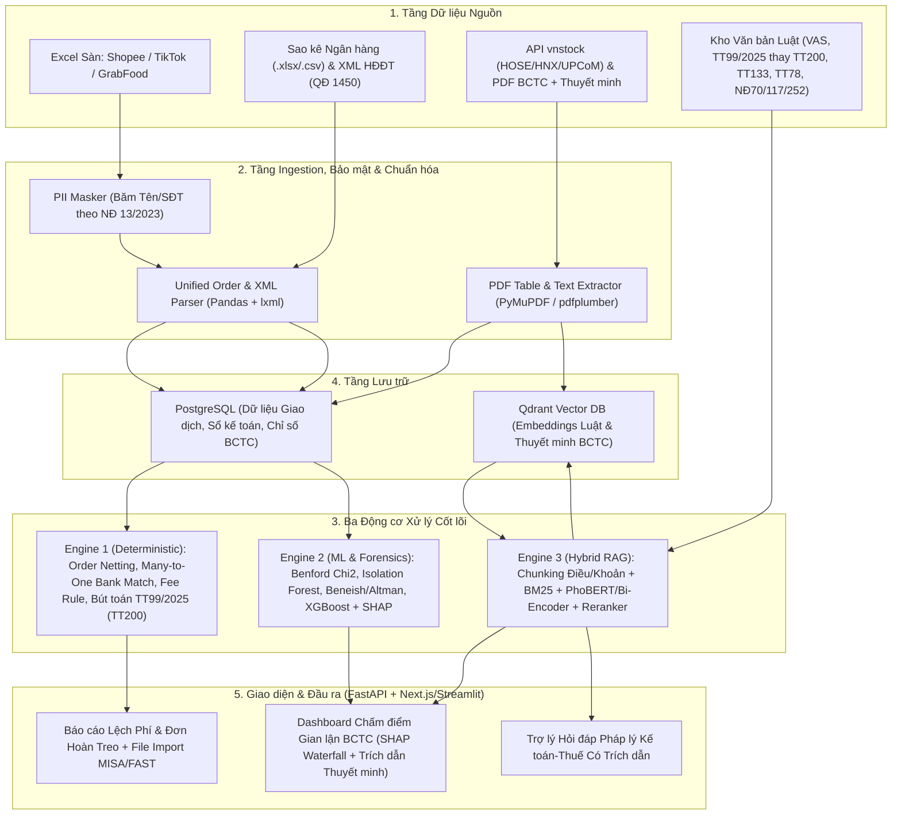

# ĐỀ ÁN CHI TIẾT: NỀN TẢNG AI KIỂM TOÁN ĐA KÊNH & PHÁP CHỨNG TÀI CHÍNH (`FinAudit AI`)

> **Phạm vi tài liệu:** Tài liệu thiết kế toàn diện từ **Cơ bản đến Nâng cao**, cầu nối song song giữa **Chuyên môn Kinh tế – Kế toán – Kiểm toán** và **Kỹ thuật Phần mềm – Dữ liệu – Mô hình AI**.  
> **Cấu trúc 2 Phân hệ Tích hợp:**  
> 1. **`OmniReconcile` (Cấp độ Giao dịch):** Đối soát doanh thu, phí ẩn, dòng tiền và nghĩa vụ thuế cho doanh nghiệp/F&B bán đa kênh (Shopee, TikTok Shop, GrabFood, POS, Ngân hàng, Hóa đơn điện tử).  
> 2. **`FinForensics` (Cấp độ Báo cáo Tài chính):** Phát hiện dấu hiệu thao túng số liệu, đánh giá chất lượng lợi nhuận và soi chéo Thuyết minh BCTC cho kiểm toán viên, ngân hàng thẩm định tín dụng và nhà đầu tư.

---

## PHẦN 1: BỐI CẢNH THỊ TRƯỜNG, SỐ LIỆU THỰC TẾ & KHOẢNG TRỐNG GIẢI PHÁP

### 1.1. Bức tranh Thực tế & Số liệu Chứng minh Nhu cầu Cấp thiết
Thị trường Việt Nam đang trải qua làn sóng **"Minh bạch hóa tài chính & Siết chặt quản lý thuế số"** mạnh nhất từ trước đến nay, tạo ra nhu cầu bắt buộc phải tự động hóa kiểm soát sổ sách:

1. **Quy mô bùng nổ và sự sàng lọc của Thương mại Điện tử (TMĐT):**
   - Theo số liệu tổng hợp từ nền tảng dữ liệu **Metric** (và các báo cáo thị trường TMĐT Việt Nam 2024–2025): Tổng doanh số (GMV) 4 sàn TMĐT lớn năm 2025 đạt **429.700 tỷ đồng** (~16 tỷ USD), **tăng 34,75%** so với năm 2024 (~320.000–330.000 tỷ đồng), với gần **3,94 tỷ sản phẩm** tiêu thụ.
   - Thị trường tập trung tới **~97% thị phần** vào **Shopee (56,04%)** và **TikTok Shop (41,31%)**. Đáng chú ý, tổng số shop phát sinh đơn năm 2025 **giảm 7,43%** (từ hơn 650.000 shop xuống còn ~601.800 shop) do chi phí vận hành/phí sàn tăng và áp lực siết thuế, trong khi nhóm *Shop Mall* (chiếm >2% lượng shop) đóng góp tới hơn **32% tổng doanh số**.
2. **Sức ép Chuyển đổi số Kế toán – Thuế đối với SME & Hộ kinh doanh:**
   - Việt Nam có **gần 5 triệu hộ kinh doanh** và **hơn 850.000 doanh nghiệp** đang chịu tác động trực tiếp từ lộ trình xóa bỏ thuế khoán sang thuế kê khai, kết hợp các quy định mới:
     - **Thông tư 78/2021/TT-BTC** & **Nghị định 70/2025/NĐ-CP**: Bắt buộc hóa đơn điện tử (HĐĐT) khởi tạo từ máy tính tiền đối với bán lẻ, ăn uống (F&B).
     - **Nghị định 117/2025/NĐ-CP** (hiệu lực 01/07/2025) & **Nghị định 252/2026/NĐ-CP**: Sàn TMĐT có chức năng thanh toán phải **khấu trừ và nộp thuế thay** ngay từng giao dịch cho hộ/cá nhân kinh doanh (ngưỡng doanh thu chịu thuế GTGT/TNCN áp dụng từ 01/01/2026 là **trên 1 tỷ đồng/năm**).
3. **Nỗi đau về Chất lượng BCTC và Rủi ro Tín dụng – Kiểm toán:**
   - Tại Việt Nam, tình trạng doanh nghiệp "làm đẹp" BCTC (thổi phồng doanh thu, giấu nợ xấu trong *Phải thu khác*, lợi nhuận kế toán dương nhưng dòng tiền hoạt động `CFO` âm liên tục) khiến ngân hàng thương mại, công ty kiểm toán và nhà đầu tư đối mặt rủi ro mất vốn nghiêm trọng nếu chỉ đọc các chỉ số bề nổi.

### 1.2. Đánh giá Các Giải pháp Hiện có & Khoảng trống Đột phá (Market Gaps)

| Nhóm Giải pháp Hiện có | Đại diện Tiêu biểu | Điểm mạnh Hiện tại | Tồn đọng & Khoảng trống Chưa giải quyết được |
| :--- | :--- | :--- | :--- |
| **Phần mềm Kế toán & Bán hàng SME** | **MISA AMIS / eShop, Sapo, KiotViet, FAST** | Bám sát chế độ kế toán TT 99/2025 (thay thế TT 200/2014 từ 01/01/2026) & TT 133; kết nối API đồng bộ đơn hàng sàn TMĐT cơ bản; phát hành HĐĐT. | 1) Kết nối API thường giới hạn quyền chủ shop và đòi hỏi chuẩn hóa mã hàng (SKU) đồng bộ ngay từ đầu. 2) **Thiếu tầng Kiểm toán Pháp chứng (Forensic Audit):** Không tự phát hiện sàn trừ sai % hoa hồng hợp đồng, không theo dõi tuổi nợ đơn hoàn treo (`TK 138`) quá hạn chưa hoàn tiền/hàng, chưa chạy Luật Benford trên hóa đơn đầu vào. 3) Chưa tự động tách bạch và đối chiếu phần thuế sàn đã khấu trừ thay (theo NĐ 117/2025 & NĐ 252/2026) để tránh nộp trùng thuế. |
| **Nền tảng Phân tích BCTC & Chứng khoán** | **FiinPro, Vietstock, Simplize** | Cung cấp dữ liệu lịch sử hàng nghìn doanh nghiệp đại chúng, chuẩn hóa ngành (ICB), tính sẵn P/E, P/B, ROE, ROA; FiinPro có FiinPro-X MCP cho tổ chức lớn. | 1) **Chi phí cao** (FiinPro dành cho tổ chức/quỹ) hoặc **chỉ dừng ở chỉ số bề mặt** (Vietstock/Simplize). 2) **Chưa đánh giá "Chất lượng lợi nhuận" (Earnings Management):** Không có mô hình ML học từ lịch sử doanh nghiệp bị ngoại trừ/điều chỉnh hồi tố tại VN. 3) **Đứt gãy giữa Số và Chữ:** Không tự động đối chiếu biến động số bất thường trên BCĐKT với đoạn văn giải trình bên trong file PDF Thuyết minh BCTC. |

### 1.3. Tính Mới & Đột Phá Của `FinAudit AI`
1. **Kiến trúc "2 Tầng Liên Thông" (Transaction Truth $\rightarrow$ Statement Forensics):** Kết nối trực tiếp từ kiểm toán từng giao dịch nhỏ lẻ (Sàn/App F&B/Ngân hàng/XML) lên phân tích sức khỏe BCTC tổng hợp.
2. **Nguyên tắc "Tính Toán Xác Định + AI Giải Thích" (Deterministic Core + XAI + Grounded RAG):** Không để LLM tự cộng trừ gây sai số kế toán; mọi con số do Python/SQL tính chuẩn xác 100%, ML/SHAP tìm điểm bất thường, và Hybrid RAG chỉ làm nhiệm vụ *tra cứu căn cứ pháp lý (VAS/Thuế)* và *đối chiếu Thuyết minh BCTC*.
3. **Zero-Friction Onboarding (Không kẹt API):** Phân hệ 1 nhận thẳng file Excel/CSV xuất sẵn từ Seller Center và thư mục `.xml` TT78 — triển khai được trong **5 phút** mà không cần chờ duyệt API sàn hay Open Banking.

---

## PHẦN 2: GIẢI PHÁP DƯỚI GÓC NHÌN KẾ TOÁN – KIỂM TOÁN – KINH TẾ (Từ Cơ bản đến Nâng cao)

Phần này giúp người làm **Kế toán, Kiểm toán, Kinh tế** nắm rõ bản chất nghiệp vụ mà hệ thống giải quyết, đồng thời làm tài liệu đặc tả nghiệp vụ (Business Logic) cho **Kỹ sư phần mềm**.

### 2.1. Phân hệ 1 (`OmniReconcile`): Giải mã "Ma trận Phí, Hoàn Đơn & Thuế" Đa kênh

#### A. Kiến thức Nền tảng (Cơ bản): Sai lầm chết người "Ghi nhận Doanh thu = Tiền về Ngân hàng"
* **Vấn đề kế toán:** Một quán F&B bán qua **GrabFood** hoặc shop bán trên **Shopee / TikTok Shop** có đơn hàng giá niêm yết **500.000 đ**. Sau khi trừ: phí hoa hồng/cố định (VD: 50.000 đ), phí thanh toán/dịch vụ (25.000 đ), mã giảm giá shop tự tài trợ (20.000 đ), tiền thực tế chuyển về tài khoản ngân hàng chỉ còn **405.000 đ**.
  - Nếu kế toán lấy luôn số `405.000 đ` trên sao kê ngân hàng để khai doanh thu: **Sai nghiêm trọng!** Vì Cơ quan Thuế quản lý dựa trên dữ liệu **Doanh thu gộp** sàn báo cáo (sau khi trừ giảm giá hợp lệ của người bán: `480.000 đ`), chứ không phải tiền ròng về ví. Khai thiếu sẽ bị truy thu thuế và phạt chậm nộp.
  - Ngược lại, nếu chỉ nhìn tiền về, chủ doanh nghiệp **không biết mình đang bị sàn trừ bao nhiêu % phí**, hay có bao nhiêu đơn khách bấm hoàn hàng nhưng shipper làm mất hàng mà sàn chưa đền bù.

#### B. Quy trình Định khoản & Đối chiếu Chuẩn (Mức Trung cấp — Theo Thông tư 99/2025/TT-BTC thay thế TT 200/2014/TT-BTC & TT 133/2016/TT-BTC)
Hệ thống tự động hóa 4 bước hạch toán chuẩn cho từng vòng đời đơn hàng:

1. **Khi đơn hàng giao thành công (Ghi nhận Doanh thu gộp & Công nợ phải thu sàn):**
   - `Nợ TK 131` (Phải thu khách hàng – Chi tiết theo Sàn Shopee/TikTok/Grab): `480.000 đ` *(Giá bán sau chiết khấu của shop)*
   - `Có TK 511` (Doanh thu bán hàng và cung cấp dịch vụ): `436.364 đ` *(hoặc tách đúng thuế suất 8%/10%)*
   - `Có TK 3331` (Thuế GTGT phải nộp — nếu DN tự kê khai): `43.636 đ`
2. **Khi sàn cấn trừ phí hoa hồng, phí dịch vụ, phí quảng cáo nội sàn:**
   - `Nợ TK 641 / TK 642` (Chi phí bán hàng / Quản lý DN): `68.182 đ` *(theo hóa đơn phí sàn xuất cho shop)*
   - `Nợ TK 1331` (Thuế GTGT đầu vào được khấu trừ của phí sàn): `6.818 đ`
   - `Có TK 131` (Cấn trừ trực tiếp vào công nợ phải thu sàn): `75.000 đ`
3. **Khi tiền thực nhận về tài khoản Ngân hàng:**
   - `Nợ TK 112` (Tiền gửi ngân hàng): `405.000 đ`
   - `Có TK 131` (Tất toán công nợ sàn cho các đơn trong kỳ payout): `405.000 đ`
4. **Khi phát sinh Đơn hoàn / Khiếu nại mất hàng (Rủi ro thất thoát hay bị bỏ quên):**
   - Ghi nhận giảm trừ doanh thu (`Nợ TK 521 / Có TK 131`) nếu hàng về kho nguyên vẹn; **hoặc** treo sang `Nợ TK 1388` (Phải thu khác – bồi thường từ sàn/đơn vị vận chuyển) nếu quá `15 ngày` chưa nhận lại hàng và chưa có tiền đền bù.
5. **Xử lý đặc thù cho Hộ/Cá nhân kinh doanh (NĐ 117/2025 & NĐ 252/2026):**
   - Hệ thống bóc tách riêng cột **Thuế GTGT & TNCN sàn đã khấu trừ nộp thay** trên từng đơn để đối chiếu với ngưỡng miễn thuế **1 tỷ đồng/năm** (từ 01/01/2026), làm bằng chứng chứng minh đã hoàn thành nghĩa vụ thuế, tránh nộp trùng khi tự kê khai.

#### C. Kiểm toán Hóa đơn Đầu vào & Chống Gian lận Chi phí (Mức Nâng cao)
- **Kiểm toán 100% XML Hóa đơn đầu vào (TT 78 / QĐ 1450/QĐ-TCT):** Kiểm tra tự động 100% file XML (chữ ký số, mã cơ quan thuế, MST người bán có bị rủi ro bỏ trốn không, phép tính dòng hàng).
- **Quy luật Benford (Benford's Law):** Trong dữ liệu tài chính tự nhiên, chữ số đầu tiên là `1` xuất hiện khoảng **30,1%**, giảm dần đến `9` chỉ khoảng **4,6%**. Nếu chuỗi hóa đơn từ một nhà cung cấp hoặc chi phí vận hành của một cửa hàng vi phạm phân phối Benford (ví dụ: nhiều hóa đơn bắt đầu bằng số `9` hoặc `4` như `4.900.000 đ`, `9.800.000 đ`, `19.500.000 đ`), đó là dấu hiệu **chia nhỏ hóa đơn (split-invoicing)** để né ngưỡng thanh toán không dùng tiền mặt hoặc né thẩm quyền duyệt chi của cấp trên.

---

### 2.2. Phân hệ 2 (`FinForensics`): Pháp chứng BCTC & Phát hiện Thủ thuật Kế toán

#### A. Kiến thức Nền tảng (Cơ bản): Đừng chỉ nhìn Lợi nhuận ròng (Net Income)
Một doanh nghiệp có thể báo lãi tăng 40%/năm trên Báo cáo Kết quả Kinh doanh (KQKD), nhưng thực chất đang "hấp hối" vì 3 lý do kinh điển:
1. **Ghi nhận doanh thu ảo (Channel Stuffing / Early Recognition):** Đẩy hàng sang đại lý cuối năm nhưng không thu được tiền $\rightarrow$ `Doanh thu` tăng, `Phải thu khách hàng` phình to, nhưng `Dòng tiền thuần từ hoạt động kinh doanh (CFO)` lại âm.
2. **Giấu chi phí / Vốn hóa sai quy định:** Đẩy chi phí hoạt động lẽ ra phải trừ ngay vào KQKD sang tài khoản *Chi phí xây dựng cơ bản dở dang* hoặc *Tài sản dài hạn khác* để làm đẹp lợi nhuận ngắn hạn.
3. **Che giấu nợ xấu / Rút ruột vốn:** Chuyển tiền cho công ty sân sau dưới danh nghĩa *Trả trước cho người bán ngắn hạn*, *Phải thu khác*, hoặc *Cho vay ngắn hạn* mà không trích lập dự phòng phải thu khó đòi (`TK 2293`) trên BCTC theo quy định pháp luật về kế toán (**Thông tư 99/2025/TT-BTC** áp dụng từ 01/01/2026 thay thế **Thông tư 200/2014/TT-BTC**, kết hợp đối chiếu khung tham chiếu tuổi nợ & chi phí thuế TNDN tại **Thông tư 48/2019/TT-BTC**).

#### B. Hệ thống Chỉ số Pháp chứng Kinh điển (Mức Trung cấp)
Hệ thống tính tự động hai bộ mô hình nền tảng kết hợp bộ chỉ số đặc thù Việt Nam:

1. **Mô hình Beneish M-Score (8 biến số phát hiện thao túng lợi nhuận):**
   $$M = -4.84 + 0.920\text{DSRI} + 0.528\text{GMI} + 0.404\text{AQI} + 0.892\text{SGI} + 0.115\text{DEPI} - 0.172\text{SGAI} + 4.679\text{TATA} - 0.327\text{LVGI}$$
   - Trong đó:
     - `DSRI` (Chỉ số ngày phải thu): Phải thu tăng nhanh hơn doanh thu $\rightarrow$ nghi vấn doanh thu ảo.
     - `GMI` (Chỉ số biên lãi gộp): Biên lãi gộp suy giảm $\rightarrow$ áp lực gian lận tăng.
     - `AQI` (Chỉ số chất lượng tài sản): Tài sản dài hạn "mờ ám" (không phải TSCĐ hữu hình) tăng tỷ trọng $\rightarrow$ nghi vấn vốn hóa chi phí.
     - `SGI` (Tăng trưởng doanh thu), `DEPI` (Tỷ lệ khấu hao giảm để nâng lãi), `SGAI` (Chi phí bán hàng/quản lý), `LVGI` (Đòn bẩy nợ), `TATA` (Tổng dồn tích $= \frac{\text{LN từ HĐKD} - \text{CFO}}{\text{Tổng tài sản}}$).
   - *Lưu ý thực chứng tại VN:* Ngưỡng gốc của Mỹ là `M > -1.78`, nhưng các nghiên cứu trên sàn HOSE/HNX cho thấy doanh nghiệp Việt Nam có đặc thù chuẩn VAS và cấu trúc vốn vay ngân hàng cao, do đó **không nên chỉ dùng hệ số tĩnh của Mỹ** mà cần hiệu chỉnh bằng mô hình Học máy bên dưới.

2. **Mô hình Altman Z-Score (Đánh giá rủi ro kiệt quệ tài chính):** Kết hợp 5 tỷ số về vốn lưu động, lợi nhuận giữ lại, EBIT, vốn chủ sở hữu/nợ phải trả và vòng quay tài sản để xếp vùng *An toàn / Xám / Nguy hiểm*.

3. **Chỉ số Chất lượng Dòng tiền & Giao dịch Bên liên quan:**
   - $\text{Quality of Earnings} = \frac{\text{CFO}}{\text{Lợi nhuận sau thuế}}$ (bền vững khi $\ge 1$; báo động đỏ nếu $< 0.5$ trong 2–3 năm liên tiếp).
   - Tỷ lệ `(Phải thu khác + Trả trước người bán + Đầu tư tài chính ngắn hạn khác) / Tổng tài sản`.

#### C. Học máy Thích ứng Chuẩn VAS & Soi chéo Thuyết minh BCTC (Mức Nâng cao)
- Khi dùng thuật toán **XGBoost** kết hợp các biến tài chính trên dữ liệu hàng nghìn năm-quan sát (firm-year observations) trên HOSE/HNX (với nhãn từ các công ty từng nhận ý kiến kiểm toán ngoại trừ hoặc bị điều chỉnh hồi tố trọng yếu), các nghiên cứu thực nghiệm tại Việt Nam ghi nhận **XGBoost đạt AUC-ROC xấp xỉ 0.93**, vượt trội mô hình thống kê tuyến tính truyền thống.
- Kết hợp **SHAP (Explainable AI)** và **RAG trên PDF Thuyết minh BCTC**: Hệ thống không chỉ đưa ra một điểm số vô hồn (VD: *"Rủi ro: 82/100"*), mà tự động giải trình: *"Điểm rủi ro cao do Chỉ số Phải thu (`DSRI = 1.68`) và Khoản mục Trả trước người bán tăng 115%. Theo Trang 28 Thuyết minh BCTC, 72% khoản trả trước này tập trung tại Công ty TNHH X (bên liên quan mới thành lập), chưa có thuyết minh chi tiết tài sản đảm bảo."*

---

## PHẦN 3: THIẾT KẾ KỸ THUẬT, DỮ LIỆU & XÂY DỰNG MÔ HÌNH AI (Dành cho Đội ngũ Kỹ thuật)

Phần này cung cấp đầy đủ thông số để kỹ sư Backend, Data Engineer và AI Engineer bắt tay vào thiết lập và code ngay.

### 3.1. Kiến trúc Hệ thống Tổng thể

### 3.2. Đặc tả Dữ liệu Đầu vào & Cấu trúc Bảng Chính (Data Specification)

#### A. Dữ liệu Phân hệ 1 (`OmniReconcile`) — Schema thực tế
1. **TikTok Shop Settlement Export (`Statements/Payouts`):**
   - Cột bắt buộc map: `Statement Date`, `Statement ID`, `Payment ID`, `Order/Adjustment ID`, `SKU ID`, `Type` (`Order`, `Refund`, `Adjustment`, `Reserve`), `Gross Sales`, `Platform Discounts`, `Seller Discounts`, `Commission Fee`, `Transaction Fee`, `Affiliate Commission`, `Refund Amount`, `Settlement Amount`.
2. **Shopee Income Escrow Export:**
   - Cột bắt buộc map: `Order SN`, `Payout Date`, `Original Price`, `Product Deal Price`, `Shopee Rebate`, `Seller Vouchers`, `Actual Shipping Cost`, `Commission Fee`, `Service Fee`, `Transaction Fee`, `Escrow Amount`.
3. **Hóa đơn điện tử XML (Chuẩn Tổng cục Thuế — Quyết định 1450/QĐ-TCT):**
   - Dùng `lxml` với XPath bỏ qua namespace (`.//{*}TagName`) để đọc an toàn giữa các nhà cung cấp HĐĐT khác nhau:
     - Chung: `KHMSHDon`, `KHHDon`, `SHDon`, `NLap`, `MCCQT`.
     - Người bán/mua: `NBan/MST`, `NBan/Ten`, `NMua/MST`.
     - Chi tiết dòng hàng (`DSHHDV/HHDV`): `TChat` (1: hàng hóa, 2: khuyến mại, 3: chiết khấu), `THHDV`, `SLuong`, `DGia`, `ThTien`, `TSuat`.
     - Tổng tiền (`TToan`): `TgTCThue`, `TgTThue`, `TgTTTBSo`.

#### B. Dữ liệu Phân hệ 2 (`FinForensics`) — Lấy trực tiếp từ `vnstock`
- Nguồn công khai: `pip install -U vnstock` (`github.com/thinh-vu/vnstock`).
- Gọi `fin = Fundamental().equity("FPT")`:
  - `fin.income_statement(period="year")` (hoặc `"quarter"`)
  - `fin.balance_sheet(period="year")`
  - `fin.cash_flow(period="year")`
  - `fin.ratio(period="year")` & `fin.note(period="year")`
  - `fin.filing()` (trả về URL tải file PDF BCTC & Thuyết minh gốc).
- **Xử lý thiếu dữ liệu (Missing Data Imputation) cho BCTC VN:** Nhiều doanh nghiệp không có giá trị ở mục `Khấu hao` riêng trên KQKD (nằm trong Thuyết minh hoặc LCTT) $\rightarrow$ Luôn lấy `Khấu hao TSCĐ` từ **Báo cáo Lưu chuyển tiền tệ gián tiếp** trước khi tính `DEPI` trong Beneish M-Score; nếu thiếu thông số kỳ $t-1$, gắn cờ `insufficient_history` thay vì điền số `0` làm méo tỷ số.

### 3.3. Chi tiết Thiết kế 4 Lớp Thuật toán & Kiểm soát Rủi ro Mô hình

| Lớp | Tên Kỹ thuật / Mô hình | Đầu vào | Logic / Công thức Cốt lõi | Đầu ra & Cách chống lỗi |
| :--- | :--- | :--- | :--- | :--- |
| **Lớp 1: Chuẩn hóa & Đối chiếu Xác định** | `Order-Lifecycle Netting` + `Many-to-One Bank Matching` | Dữ liệu đơn hàng, Settlement lines, Sao kê ngân hàng | 1) Group by `Order ID` để cộng dồn `Order (+) + Refund (-) + Adjustment (+/-)`. 2) Khớp `Statement ID` với Memo ngân hàng; nếu không có ID, chạy thuật toán **Subset-Sum / Window Matching** trong $[T, T+3\text{ ngày}]$ với sai số $\le 1.000\text{ đ}$. 3) Áp rule `Commission Rate` vs. Hợp đồng. | Bảng khớp lệnh chi tiết từng đơn + Danh sách ngoại lệ (`Phí vượt hợp đồng`, `Đơn hoàn >15 ngày chưa tất toán TK 138`) + File bút toán MISA/FAST. |
| **Lớp 2: Phát hiện Bất thường Không giám sát** | `Benford's Law (Chi-square)` + `Isolation Forest` | Chuỗi giá trị hóa đơn đầu vào; các đặc trưng đơn hàng theo ngày/SKU | - Tính tần suất chữ số đầu tiên $d \in \{1..9\}$ so với $P(d) = \log_{10}(1 + 1/d)$ qua kiểm định $\chi^2$ ($p < 0.05$ khi $n \ge 50$). - `Isolation Forest` (`contamination=0.03–0.05`) trên bộ vector `[fee_ratio, shipping_diff, refund_lag_days, discount_ratio]`. | Cảnh báo NCC có dấu hiệu chia nhỏ hóa đơn + Điểm bất thường (Anomaly Score) cho từng lô đơn hàng. |
| **Lớp 3: Pháp chứng BCTC Có Giải thích** | `Beneish M-Score` + `XGBoost` + `SHAP` | Bảng CĐKT, KQKD, LCTT nhiều kỳ (từ `vnstock` / Excel BCTC) | - Tính 8 biến Beneish + Altman Z + `Accrual Ratio` + `CFO/NI` + biến động `Phải thu khác / Tổng TS`. - Xử lý mất cân bằng nhãn (Imbalanced Data: số DN gian lận/ngoại trừ ít hơn nhiều DN bình thường) bằng `scale_pos_weight` trong XGBoost. - Chạy `TreeExplainer` (SHAP) cho từng dự đoán. | Xác suất rủi ro BCTC (`0–100`) + Biểu đồ/Danh sách **Top 5 chỉ số kéo điểm rủi ro lên** để người dùng kiểm tra đúng chỗ. |
| **Lớp 4: RAG Pháp lý & Thuyết minh BCTC** | `Hierarchical Chunking` + `Hybrid Retrieval (BM25 + Dense Vector)` + `Reranker` | PDF Thuyết minh BCTC + Kho văn bản Luật VN (VAS, TT 99/2025 thay thế TT 200/2014, TT 133, TT 48/2019, TT 78, NĐ 70/117/252) | - Chunk văn bản luật theo cấu trúc cây: `Văn bản -> Chương -> Điều -> Khoản` (giữ nguyên metadata số điều/khoản). - Truy vấn lai: `BM25` (bắt chính xác số hiệu thông tư, mã TK `131`, `138`, `511`) + Dense Vector (`bkai-foundation-models/vietnamese-bi-encoder` hoặc `PhoBERT`) + Cross-Encoder Reranking. - Prompt bắt buộc trích dẫn nguồn; thiếu nguồn $\rightarrow$ từ chối suy đoán. | Đoạn giải trình đối chiếu giữa số liệu SHAP gắn cờ và văn bản Thuyết minh BCTC + Tư vấn định khoản/thuế có dẫn chứng Điều/Khoản. |

---

## PHẦN 4: CHỨNG MINH TÍNH KHẢ THI & ỨNG DỤNG THỰC TẾ

### 4.1. Khả thi về Nguồn lực Kỹ thuật (Mã nguồn mở & Thư viện Sẵn có)
Đội ngũ kỹ thuật không cần xây lại từ đầu mà có thể kế thừa và mở rộng từ các dự án thực tế đã được kiểm chứng trên GitHub:
- **Dữ liệu BCTC Việt Nam:** `thinh-vu/vnstock` (lấy toàn bộ BCTC, chỉ số tài chính, thuyết minh và link PDF gốc của doanh nghiệp niêm yết HOSE/HNX/UPCoM).
- **Đối soát TMĐT Việt Nam:** `HoangNgMi/qami` (tham khảo logic ETL bảng P&L TikTok Shop, xử lý netting hoàn đơn `Z04` và đối chiếu phí `Z10`).
- **Phát hiện bất thường kết hợp LLM:** `Jabonsote/Financial-Anomaly-Detection-with-DeepSeek-and-Isolation-Forest` (mô hình Isolation Forest kết hợp LLM viết báo cáo giải trình bất thường tài chính).
- **RAG Tiếng Việt & Pháp lý:** `NamSyntax/vietnamese-rag-system` (pipeline Hybrid Retrieval + Qdrant/Redis + Docker + đánh giá LLM-as-a-judge) và `khanghoang123/vietnamese-legal-rag-portfolio` (Hybrid Search + Reranking + trích dẫn nguồn chuẩn xác).
- **OCR Hóa đơn Tiếng Việt (cho hóa đơn/chứng từ scan):** `HoVDuc/OCR-invoice` (PaddleOCR / LayoutXLM / VLM cho hóa đơn Việt Nam).

### 4.2. Khả thi về Hiệu quả Nghiệp vụ & Mô hình Kinh doanh (Unit Economics)
- **Giá trị đo được ngay cho khách hàng:**
  - *Với Shop TMĐT / Chuỗi F&B (Phân hệ 1):* Rút ngắn thời gian đối soát sàn & lập bảng kê hạch toán cuối tháng từ **3–5 ngày thủ công xuống còn < 15 phút**; phát hiện ngay các khoản phí ẩn bị trừ sai hoặc đơn hoàn treo lâu ngày chưa nhận lại tiền (chỉ cần tìm lại được 1–2% tiền hoàn thất lạc/phí sai là đã vượt xa chi phí thuê phần mềm hàng tháng).
  - *Với Kiểm toán viên / Tín dụng Ngân hàng / Nhà đầu tư (Phân hệ 2):* Giảm **60%–70%** thời gian đọc lướt BCTC và Thuyết minh 50–80 trang khi sàng lọc hồ sơ; giúp tập trung nguồn lực kiểm tra sâu đúng các doanh nghiệp và khoản mục có rủi ro trọng yếu cao.
- **Chiến lược Tiếp cận Thị trường (Go-to-Market) Thực tế:**
  - Thay vì đi bán lẻ từng shop tốn chi phí marketing cao, đánh vào kênh **B2B2C qua các Công ty Dịch vụ Kế toán & Đại lý Thuế** (ví dụ hệ sinh thái kết nối hàng chục nghìn chuyên gia kế toán – thuế tại VN): bán cho 1 đại lý thuế là tiếp cận được **20–100 doanh nghiệp SME/hộ kinh doanh** mà họ đang làm sổ sách hàng tháng.

### 4.3. Bộ Chỉ số Nghiệm thu Kỹ thuật (Bắt buộc đạt trước khi triển khai thật)
1. **Reconciliation Match Rate:** Khớp được $\ge 98\%$ dòng tiền sao kê ngân hàng với các kỳ quyết toán sàn TMĐT.
2. **XML & Accounting Arithmetic Accuracy:** **100%** chính xác phép tính số học trên hóa đơn XML và cân bằng `Tổng Nợ = Tổng Có` ở mọi bút toán sinh ra.
3. **Forensic Model Performance:** Trên tập dữ liệu BCTC doanh nghiệp niêm yết VN có kiểm soát mất cân bằng (so sánh với lịch sử ý kiến kiểm toán ngoại trừ/điều chỉnh trọng yếu), kiểm thử theo thời gian thực tế (`Time-based Split` — train năm cũ, test năm mới để tránh rò rỉ dữ liệu tương lai `Data Leakage`), mục tiêu đạt **AUC-ROC $\ge 0.85–0.90$** và kiểm tra độ hợp lý của **SHAP top features** với chuyên gia kiểm toán.
4. **RAG Groundedness & Citation Accuracy:** $\ge 95\%$ câu trả lời trích dẫn đúng số hiệu Điều/Khoản hoặc số trang Thuyết minh PDF gốc; **0%** tự bịa số liệu kế toán.

---

## PHẦN 5: QUY TRÌNH TỪNG BƯỚC THỰC HIỆN DỰ ÁN (TỪ CON SỐ 0 ĐẾN TRIỂN KHAI)

Bảng lộ trình phối hợp chặt chẽ giữa **Đội Kinh tế – Kế toán – Kiểm toán (Biz/Domain)** và **Đội Kỹ thuật – AI (Tech/Data)**:

### Giai đoạn 0: Thiết lập Nền tảng & Bộ Dữ liệu Chuẩn (Tuần 1–2)
- **Đội Kế toán – Kiểm toán:**
  - Thu thập mẫu file Export thật (đã ẩn danh thông tin cá nhân) của Shopee, TikTok Shop, GrabFood, 10–20 file XML hóa đơn đầu vào chuẩn TT78, và sao kê ngân hàng tương ứng.
  - Chuẩn hóa **Bảng ánh xạ Tài khoản Kế toán** (TT 99/2025 thay thế TT 200/2014 & TT 133) cho từng loại giao dịch TMĐT/F&B.
  - Lập danh sách văn bản pháp lý chuẩn (VAS, TT 99/2025, TT 200/2014, TT 133, TT 48/2019, TT 78, NĐ 70/2025, NĐ 117/2025, NĐ 252/2026) và chọn 20–30 mã cổ phiếu HOSE/HNX điển hình (gồm cả doanh nghiệp khỏe và doanh nghiệp từng bị ý kiến kiểm toán ngoại trừ/điều chỉnh lớn) làm tập đối chứng.
- **Đội Kỹ thuật – AI:**
  - Dựng khung dự án (`FastAPI` + `PostgreSQL` + `Qdrant` + `Docker Compose`).
  - Viết script thu thập BCTC lịch sử toàn thị trường qua `vnstock` và tải PDF Thuyết minh BCTC qua `fin.filing()`.
  - Thiết lập bộ kiểm thử tự động (`pytest`) cho toàn bộ phép tính kế toán.

### Giai đoạn 1: Xây dựng Phân hệ 1 — `OmniReconcile` Core (Tuần 3–5)
- **Đội Kỹ thuật – AI:**
  - Xây dựng `XML Parser` (`lxml`) đọc hàng loạt hóa đơn TT78 + kiểm tra chéo phép tính + tích hợp kiểm định **Benford's Law**.
  - Viết module chuẩn hóa file Shopee / TikTok Shop / GrabFood (xử lý `Order-Lifecycle Netting`) và thuật toán khớp nhiều-về-một với sao kê ngân hàng.
  - Lập trình `Rule Engine` phát hiện phí vượt hợp đồng, đơn hoàn treo quá 15 ngày (`TK 1388`), và tính thuế khấu trừ thay theo NĐ 117/252.
- **Đội Kế toán – Kiểm toán:**
  - Kiểm tra chéo (UAT) kết quả bút toán xuất ra bằng tay trên 1 tháng dữ liệu mẫu, đảm bảo định khoản Nợ/Có khớp chuẩn để import trực tiếp vào MISA/FAST.

### Giai đoạn 2: Xây dựng Phân hệ 2 — `FinForensics` ML & XAI (Tuần 6–8)
- **Đội Kỹ thuật – AI:**
  - Viết pipeline tính toán `Beneish M-Score`, `Altman Z-Score`, `Accrual Ratio`, `CFO/NI` trên dữ liệu `vnstock` (xử lý chuẩn xác `Time-based Split` và `Missing Data`).
  - Huấn luyện `XGBoost` + `Isolation Forest` trên dữ liệu doanh nghiệp niêm yết VN, tích hợp **SHAP** giải thích trọng số rủi ro từng chỉ tiêu.
- **Đội Kế toán – Kiểm toán:**
  - Đọc kết quả SHAP trên 20 mã chứng khoán kiểm chứng; hiệu chỉnh ngưỡng cảnh báo và loại bỏ các chỉ số gây nhiễu theo đặc thù ngành (ví dụ: không áp dụng chung công thức hàng tồn kho của ngành sản xuất cho ngân hàng/bất động sản).

### Giai đoạn 3: Xây dựng Lõi `Hybrid RAG` & Giao diện Hành động (Tuần 9–10)
- **Đội Kỹ thuật – AI:**
  - Triển khai pipeline xử lý PDF Thuyết minh BCTC (`PyMuPDF`/`pdfplumber`) và văn bản luật (Hierarchical Chunking theo Điều/Khoản).
  - Cài đặt **Hybrid Search (`BM25` + `Vietnamese Bi-Encoder` + `Reranker`)** trên Qdrant; kết nối đầu ra SHAP từ Giai đoạn 2 làm câu truy vấn tự động vào đúng mục Thuyết minh BCTC.
  - Xây dựng giao diện Web (`Next.js` hoặc `Streamlit` cho MVP nhanh) tập trung vào **danh sách việc cần xử lý ngay** (Actionable Lists + Xuất Excel).
- **Đội Kế toán – Kiểm toán:**
  - Chấm điểm bộ 50 câu hỏi tình huống hạch toán thuế/VAS và đọc thuyết minh BCTC để loại bỏ hiện tượng "ảo giác" trước khi đóng băng phiên bản thử nghiệm.

### Giai đoạn 4: Bảo mật, Thí điểm Thực tế (Closed Pilot) & Thương mại hóa (Tuần 11–14)
- **Hạng mục Bảo mật Bắt buộc:**
  - Kiểm thử module **PII Masking** (ẩn danh tên, SĐT, địa chỉ người mua trên file sàn TMĐT theo **Nghị định 13/2023/NĐ-CP**).
  - Đảm bảo tách biệt luồng dữ liệu tài chính nhạy cảm (chạy toàn bộ tính toán & ML nội bộ; dùng Private VPC hoặc mô hình LLM nội bộ như `Qwen 2.5` qua `vLLM/Ollama` cho khách hàng doanh nghiệp yêu cầu bảo mật cao).
- **Triển khai Pilot:**
  - Cho **2–3 hộ kinh doanh/shop đa kênh hoặc chuỗi F&B** chạy miễn phí trên dữ liệu 3 tháng gần nhất để đo *Reconciliation Match Rate* và số tiền phí ẩn/đơn hoàn thu hồi được.
  - Cho **1–2 kiểm toán viên / chuyên viên tín dụng** dùng thử `FinForensics` trên hồ sơ doanh nghiệp thực tế để hoàn thiện mẫu Báo cáo Rủi ro PDF.
- **Thương mại hóa:** Đóng gói thành 2 gói SaaS riêng hoặc combo trọn gói, ưu tiên phân phối qua kênh **Đại lý thuế & Công ty dịch vụ kế toán** để nhân rộng tệp khách hàng SME bền vững với chi phí thu hút khách hàng (CAC) thấp.
